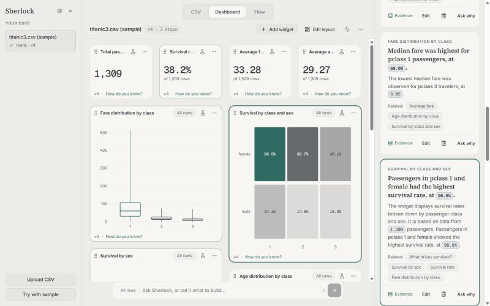
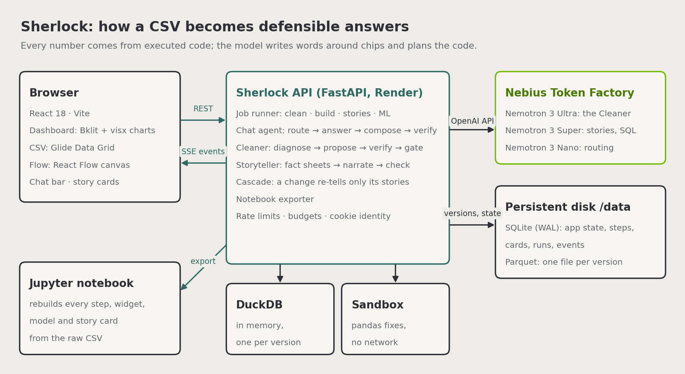
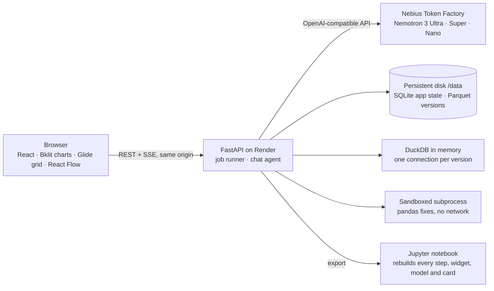

# Sherlock

Sherlock is an AI data analyst for people who own a messy CSV and need answers they can defend. It cleans the data, builds a dashboard, runs honest models and writes story cards; every number comes from executed code and traces to its source, and the whole analysis exports as a runnable Jupyter notebook.

**Hosted URL:** https://sherlock-anw3.onrender.com (Render, Frankfurt, one web service with a persistent disk). No sign-up: each browser is its own anonymous workspace.



## Try it

1. Open the URL and click **Try with sample (Titanic)**. The sample was cleaned, charted, analysed and written up once by the real models, and is cloned for you, so the dashboard and its stories appear at once.
2. Hover a widget to light up its story card; click a number chip to see the query behind it (**How do you know?**).
3. Ask in the chat bar (`/` focuses it): "average fare by class", "is fare significantly different between men and women?", "what drives survival?".
4. Open the **CSV** tab, select a cell and ask "set this to …": the change arrives as a proposal; **Approve** saves it as a new version, the widgets that read that column re-query, and only their stories are rewritten. Undo it from the Changes panel.
5. Open **Flow**, drag (or press Enter on) two or three cards from the palette, select them and click **Make sense of this**: a synthesis card appears, connected to its sources, its numbers still chips from their fact sheets.
6. **Export notebook** (⋯ menu, Ctrl+Shift+E, the Flow palette, or ask "export a notebook"): a `.ipynb` that rebuilds the current version from the raw CSV, then every widget, card and model. An example from the sample is in [`docs/examples/titanic3-v4.ipynb`](docs/examples/titanic3-v4.ipynb), with its raw file next to it.
7. Then drop your own CSV anywhere on the page.

## NVIDIA models and Nebius

Every model call goes to **NVIDIA Nemotron on Nebius Token Factory** (its OpenAI-compatible API, through the official `openai` SDK with only the base URL changed). No other model is used, and the model never computes a number: it chooses, plans and writes words around chips, and code fills every value.

| Role | Model on Token Factory | What it does in Sherlock | Median latency (live, 2026-10-25) | Per sample run (the seed build) |
|---|---|---|---|---|
| `large` | `nvidia/Nemotron-3-Ultra-550b-a55b` | The Cleaner: diagnoses each issue and writes up to three pandas fixes from our helper library, each run in a sandbox and scored by code verifiers | diagnose 2.8 s, propose 6.0 s | 13 calls, 14,501 prompt and 20,533 completion tokens |
| `medium` | `nvidia/nemotron-3-super-120b-a12b` | The Cleaner's critic; dashboard curation and titles; story cards, the overview and "make sense" syntheses; chat's SQL, compose, cell-edit proposals, widget changes and plans | critic 3.8 s, curate 9 s, story 7–10 s, chat SQL 4–7 s, compose 6–7 s | 18 calls, 11,899 prompt and 20,919 completion tokens, about $0.02 |
| `small` | `nvidia/NVIDIA-Nemotron-3-Nano-30B-A3B` | Chat routing (reasoning off) and the thread's running summary | route 1.4–3.1 s | none in the sample build; about 1,500 tokens per chat message |
| `embed` | (none) | Token Factory's catalog has no NVIDIA embedding model, so name and value matching uses `rapidfuzz` | | |

- **Why these sizes.** Ultra writes code that changes data, where a wrong fix costs most; Super does the bulk of the reasoning over facts and SQL (Nano typed chip markup into prose and ran sentences together in our trials, `FEEDBACK.md`); Nano only classifies, where speed matters most.
- **Cost.** A full sample build (cleaning, a dashboard of ten widgets, their stories, the overview, the analysis and a synthesis) took 151 s and about 68,000 tokens. Super's share is about $0.02 at Token Factory's listed $0.30 / $0.90 per million input / output tokens; Ultra's 35,000 tokens are on the account's console. A chat answer costs a fraction of a cent. An app-wide daily token budget and per-user budgets cap spend.
- **Nebius services used by the deployed app:** Token Factory only. The app is hosted on Render because the account's Nebius AI Cloud tenant was suspended; the same image runs as a Nebius Serverless Endpoint with `scripts/deploy.sh` (see Deploy).
- **Structured output.** Every structured call uses Token Factory's strict `response_format` JSON schema, validated again in code, with one repair round that sends the error back.



The same flow as a diagram GitHub draws (`scripts/architecture.py` renders the image above):



## How trust works

- **Every number has a source.** Chat answers carry **How do you know?** with the SQL, the model run or the step behind them. Story cards' numbers are chips bound to a fact sheet computed in code; the model writes words around them and can't type a digit (schema validators reject digits and numbers in words, and causal wording). A chip opens its query and the version it ran on.
- **Facts are re-checked.** Before a card is written its facts are re-run on the version; a fact that no longer holds is dropped. A synthesis's chips resolve through the cards they cite, and the card says "sources changed" when one of those numbers moves.
- **Cleaning is code you can read, and it never deletes.** Each fix is pandas the sandbox ran, checked by hard verifiers (no row loss, types kept, the blast radius limited) and gated by confidence and Super's critique. Rows it can't fix are quarantined with a reason, never dropped. Missing values stay missing unless a rule over related columns recovers them.
- **Every change is a step.** Cleaning, your edits and approved chat proposals each make a new version with Undo, so nothing changes in place. Data changes asked in chat arrive as proposals to approve or reject.
- **Honest models.** "What drives this?" compares against a majority baseline and the best one-column rule, excludes leaking and ID columns with the reason, keeps rows that share an ID-like value (a ticket, an account) in one cross-validation fold so relatives can't leak, and says "no signal" when there is none. On the sample it says sex alone does nearly as well as the model, rather than crediting the ticket number. Its metrics come from executing its own `repro.py`.
- **The notebook is the proof.** It rebuilds the current version from the raw file, step by step, and asserts it matches (row count, columns and types; `api/tests/test_notebook.py` and the notebook eval also compare every value).

## Results

| Check | Result | Command |
|---|---|---|
| Cleaning benchmark: three clean sets damaged in known ways, the Cleaner on each with the real models | recovery 97.2% (Titanic-derived), 94.5% (sales), 74.0% (HR); harm 0.00%; row loss 0.0% | `uv run sherlock eval corruption` |
| ML planted-truth cases | 3 of 3: drivers found in order with the leak and ID excluded, noise reported as "no signal", a regression's drivers ranked | `uv run sherlock eval ml` |
| Grounding: every story card's chips against their facts, facts re-run, wording scanned | Titanic 36 of 36 chips and sales 33 of 33 match their fact; 0 text runs with numbers; 0 causal phrases | `uv run sherlock eval grounding` |
| Ask-anything: 50 questions over three files, every ASK-2 area | **49 of 50**, **0 unsourced answers** (2026-10-25, after fixing what the first run's 44 of 50 found); median 8.7 s per answer before the harness began waiting out the rate limit | `uv run sherlock eval ask` |
| Notebook: export each end-to-end file and run it top to bottom in a fresh virtualenv | 5 of 5 files rebuild their version after an undo with replay (78–116 s each, 2026-10-25) | `uv run sherlock eval notebook --sets all` |
| The deployed site from fresh browsers: the instant sample, isolation, rate limits, a sourced answer, the cascade, then the five files uploaded, built (two cleaned live), exported and their notebooks run | 31 of 31 checks (2026-10-25) | `uv run --project api python scripts/live_check.py --files all` |
| End-to-end browser flow (Playwright, recorded model replies) | sample → dashboard → ask → approved edit → story update → Flow synthesis → notebook download, 11 s | `pnpm e2e` |
| Baseline: three questions on `titanic3.csv`, with Sherlock versus by hand in a spreadsheet | With Sherlock (live, 2026-10-25): about 31 s and 4 steps in all, 3 of 3 answers traceable to their SQL. The by-hand half needs a person with a stopwatch and isn't measured yet | [`docs/USER-TESTS.md`](docs/USER-TESTS.md) |
| Cold-start user test (three people who have never seen Sherlock) | not run yet; the protocol and the results table are in [`docs/USER-TESTS.md`](docs/USER-TESTS.md) | |

## Known limitations

- **Ask-anything misses.** The first live run scored 44 of 50: Nano routed two plain "what is the rate?" questions to the significance test (a code guard now keeps the test for questions that ask about one); Super used an approximate median once (the prompt now asks for exact ones); and two false "no column answers that" (the prompt now explains per-row averages). The last run scored 49 of 50: "which reviews mention damaged packaging?" still answers with a count rather than listing the rows.
- **Model variance.** At temperature 0 with reasoning on, Ultra and Super still vary between runs: three builds of the same Titanic sample got no cleaning step, then "missing age by the median for the title", then that plus "the one missing fare by its class median". Every fix is still verified and undoable.
- **Cleaning gaps.** Placeholder values in numeric columns (`N/A`, `-999`) are often quarantined rather than turned into missing values; quarantined rows keep their text and are left out of analysis.
- **Files.** A header that isn't on the first rows (as in `broken_latin1.txt`, header on row 3) must be set in the import preview. Files up to 50 MB.
- **Identity.** Anonymous and per browser, with no recovery: clearing cookies loses access. Datasets expire after 7 days.
- **Not shipped from P0** (the plan's cut order, applied on 2026-10-24 with the team solo): the settings beyond mode, accent, chat bar and after-upload; the CSV tab's range selection, copy and paste, fill down, duplicate row, undo and redo of unsaved edits, the Review changes drawer, replace (Find is there), the filter row and quick views, the cell history tooltip, selection stats, right-click menus, jump to row and Ctrl+arrow; the `predict` recipe and the linear and logistic method chooser (Auto only); brushing (click-to-filter instead); the material-change check (affected stories are always rewritten); "Rewrite this card" and "Take the story toward X" on Flow; suggested questions and the `?` shortcuts sheet. Also not shipped, outside the cuts: type-aware cell editors and autocomplete (every cell edits as text), and multi-column sort and column resize (`docs/BACKLOG.md` §2).
- **Latency.** Token Factory latency varies; we saw one 27 s routing call during an overload. Answers usually take 5–15 s. Cleaning a wide messy file is slow: the 60-column `wide_messy.csv` took 685 s for four steps on the live site; a sample-sized file takes about a minute.

## Accessibility

- Controls are real buttons, links or inputs, except the widget drag handle: moving a widget on the dashboard needs a mouse. Icon buttons are labelled. The chat bar has a `/` shortcut, Escape closes the thread, and dialogs and drawers close with Escape.
- Story cards' palette rows on Flow can be placed with Enter, and canvas nodes are reachable and deletable from the keyboard.
- Charts have a table view, and each custom chart has a text summary as its label.
- Light and dark themes with tuned contrast for text and chart marks; a Reduce motion setting, which follows the operating system's (the in-app switch is among the settings cut 1 left out, so the settings dialog has four).
- Known gaps: click-to-filter on charts is mouse-only, the slide-over panels on narrow screens don't trap focus, and some chart animations ignore reduced motion.

## Local setup and run

Requirements: [uv](https://docs.astral.sh/uv/) (Python 3.12 is pinned in `api/.python-version`), Node 24 with pnpm through Corepack (`corepack enable`), a Nebius Token Factory API key, and optionally Docker.

```bash
cp .env.example .env        # then set LLM_BASE_URL and LLM_API_KEY
uv run --project api python scripts/smoke_llm.py   # tests the Nemotron models, prints the MODEL_* lines
```

The API refuses to start until `MODEL_LARGE`, `MODEL_MEDIUM` and `MODEL_SMALL` are Nemotron IDs. Copy the lines the smoke test prints into `.env`.

With Docker:

```bash
docker compose up           # API on :8000, web on :5173
```

Without Docker:

```bash
cd api && uv sync && uv run uvicorn sherlock.main:app --reload --port 8000
cd web && pnpm install && pnpm dev
```

"Try with sample" clones the seed in `api/samples/seed/titanic3/`. To rebuild it with the real models: `uv run --project api python scripts/seed_sample.py`.

## Deploy

Sherlock is hosted on **Render**: one Docker web service built from `api/Dockerfile` with a persistent disk at `/data`, defined in [`render.yaml`](render.yaml). Every model call still goes to Nemotron on Nebius Token Factory.

1. In the Render dashboard, choose **New → Blueprint** and pick this repository.
2. When asked, enter `LLM_API_KEY`. It's `sync: false`, so it never lives in the repo.
3. Apply. Render builds the image, attaches the disk and deploys.

Later pushes to `main` that touch `api/`, `web/` or `render.yaml` redeploy once CI passes.

While GitHub Actions can't start jobs on this account (billing, since 2026-10-25), CI never passes, so nothing deploys on its own. Deploy by hand instead (TRD §11):

1. Run the checks locally: `uv run pytest` in `api/`, then `pnpm test` and `pnpm build` in `web/`.
2. Push to `main`.
3. Start a **Manual Deploy** of the service in the Render dashboard (or through the Render API).
4. Check `/healthz` and that the site serves the new build.

### Nebius alternative

The same image runs as one container on a CPU-only Nebius Serverless Endpoint (`cpu-d3`, `4vcpu-16gb`) with a Nebius shared filesystem mounted at `/data`. There, the Token Factory key is stored in a Nebius secret (SecretStash) instead of plain endpoint settings. This needs an active Nebius AI Cloud tenant with billing or credits.

Requirements: bash, Docker, `jq`, `curl` and the [Nebius CLI](https://docs.nebius.com/cli/install) with a profile for the project. On Windows, use WSL (Ubuntu) with Docker Desktop's WSL integration.

```bash
./scripts/deploy.sh setup   # once: registry, /data filesystem, secret, image, endpoint
./scripts/deploy.sh         # redeploy: build, push the same tag, restart (the URL stays the same)
./scripts/deploy.sh check   # restart and confirm /data and the cookie user survive it
```

Build and run the image locally:

```bash
docker build -f api/Dockerfile -t sherlock .
docker run -p 8080:8080 --env-file .env -e DATA_DIR=/data -e DATABASE_URL=sqlite:////data/sherlock.db -v sherlock-data:/data sherlock
```

## Tests and evals

```bash
cd api && uv run pytest     # unit and integration, with recorded model replies
cd web && pnpm test         # component tests
cd web && pnpm e2e          # builds the app and runs the Playwright flow against one local server
```

The evals in **Results** use the real models (`LLM_MOCK` unset) and print markdown tables: `uv run sherlock eval corruption | ml | grounding | ask | notebook` in `api/`.

The sandbox's OS-isolation test (workers run as the `sandbox` user and can't read protected files) needs root, so CI skips it. Run the whole API suite as root on Linux with:

```bash
docker run --rm -v "$PWD:/src:ro" -e UV_PROJECT_ENVIRONMENT=/venv ghcr.io/astral-sh/uv:python3.12-bookworm-slim sh -c 'useradd --system sandbox && cp -r /src /work && cd /work/api && rm -rf .venv && uv sync --frozen -q && chmod -R a+rX /venv /work && uv run pytest -q'
```

## License and third-party notices

MIT, see [LICENSE](LICENSE). Third-party licenses, the sample data's source and license, and the copied Bklit UI components are listed in [THIRD_PARTY.md](THIRD_PARTY.md).
