<p align="center">
  
  <br>
  <sub><i>"Holmes gave me a sketch of the events." Sidney Paget, 1892, public domain.</i></sub>
</p>

# Sherlock

**An AI data analyst you can audit.** Sherlock cleans a messy CSV into data you can defend, then answers any question about it. Every change is a step you can undo, every number in an answer comes from a query you can open, and the whole thing exports as a Jupyter notebook that rebuilds it from the raw file.

**Live:** https://sherlock-anw3.onrender.com · no sign-up, each browser is its own anonymous workspace · try the Titanic sample in one click.

- [What it is](#what-it-is)
- [What it does](#what-it-does)
- [Using Sherlock](#using-sherlock) · [Everything you can do](#everything-you-can-do)
- [How the agentic layer works](#how-the-agentic-layer-works)
- [Tech stack](#tech-stack)
- [Results](#results)
- [Known limitations](#known-limitations)
- [What's next](#whats-next)
- [Local setup](#local-setup) · [Deploy](#deploy) · [Tests and evals](#tests-and-evals)

---

## What it is

Most "chat with your data" tools have the same two problems. They answer on whatever data they're given, typos, placeholders and duplicates included. And they let a language model write the numbers, so a confident answer can be made up and you can't tell.

Sherlock is built around one rule: **the model decides, code computes.** Language models choose what to do, plan, and write code and sentences. Every number you see is put there by code, from a query or a fix that actually ran on your data. If Sherlock can't show you where a number came from, it doesn't show you the number.

It's for analysts, researchers, students and operations people who get a CSV from somewhere else and need to clean it and answer questions about it, and then defend those answers to someone who asks "how do you know?".

## What it does

| | |
|---|---|
| **Reads a messy file** | Detects the encoding, delimiter and header row, and keeps the original file untouched. Types each column only where at least 99% of values convert without loss. |
| **Finds what's wrong** | 24 code detectors (placeholders like `N/A` and `-999`, numbers stored as text, mixed date formats, typo variants of categories, garbled encoding, duplicates, summary rows, totals that don't add up, impossible values, leaking columns and more), plus checks you write yourself. |
| **Learns what columns mean** | Searches the web (Tavily) for the dataset's column definitions or a data dictionary you link, and shows each definition with the quote it came from. Your cell values are never sent. |
| **Cleans it with an agent** | A plan you review and edit, then an agent that writes a fix for each issue, tests it in a sandbox, checks it, and keeps it only if it passes. Rows it can't fix are quarantined with a reason, never deleted. |
| **Answers anything** | Numbers, tables, charts, matching rows, significance tests, "what drives this column?" (cross-validated models against baselines), what a column means, and questions about the outside world, with cited sources. |
| **Changes data on request, like a spreadsheet** | Anything you'd do by hand in Excel, asked in words: "delete row 5", "add a row with …", "delete the column cabin", "rename home.dest to destination", "trim the spaces in name", "add family_size = sibsp + parch + 1", "sort by fare". Each arrives as a card with the code, the counts and a before-and-after preview. Nothing changes until you press OK, and Undo takes it back. |
| **Proves it** | **How do you know?** on every answer shows the SQL or code that ran and the data version it ran on. Every step can be undone. **Export notebook** gives you a `.ipynb` that rebuilds the current version from the raw CSV and checks that it matches. |

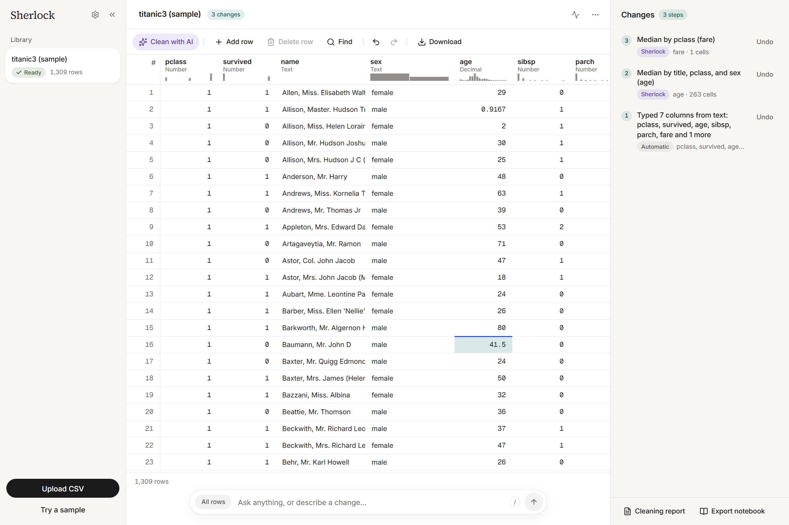

## Using Sherlock

### Your first five minutes

1. Open the [live app](https://sherlock-anw3.onrender.com) and click **Try a sample** (the Titanic passenger list). It opens straight away: the rows in the grid in the centre, the chat bar below, and the cleaning steps in the **Changes** panel on the right.
2. Open **Full cleaning report** from the Changes panel. You'll see each fix with its code, the checks it passed, and any rows it quarantined and why.

   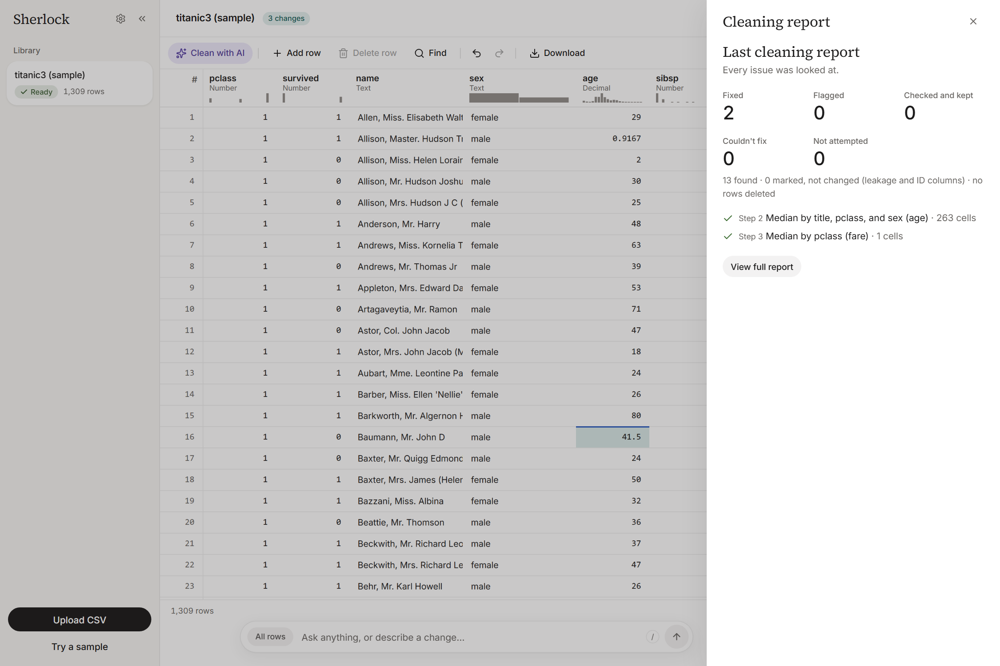

3. Ask in the chat bar (`/` focuses it):
   - "average fare by class"
   - "survival rate by sex as a chart"
   - "is fare significantly different between men and women?"
   - "what drives survival?"
   - "what does sibsp mean?"

   Click any number to see the query behind it.

   | | |
   |---|---|
   | 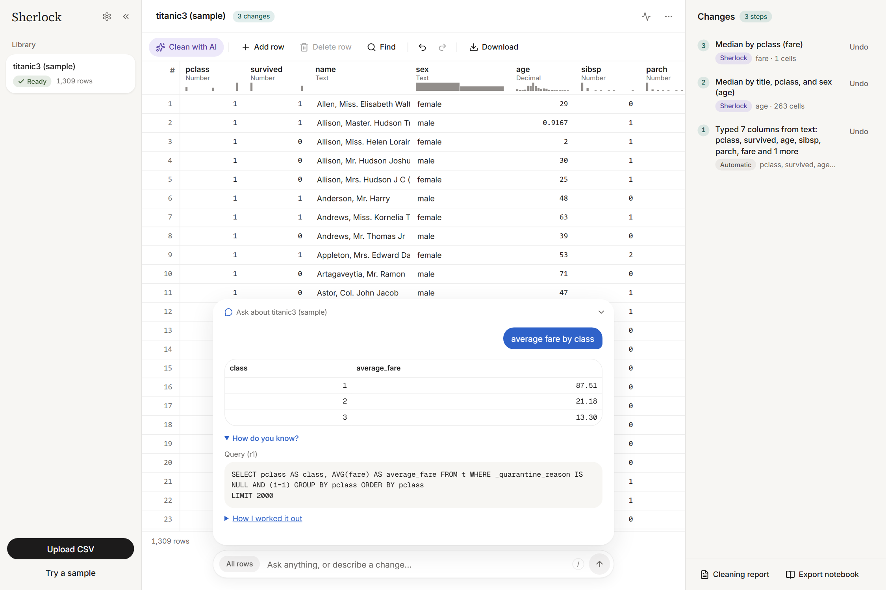 | 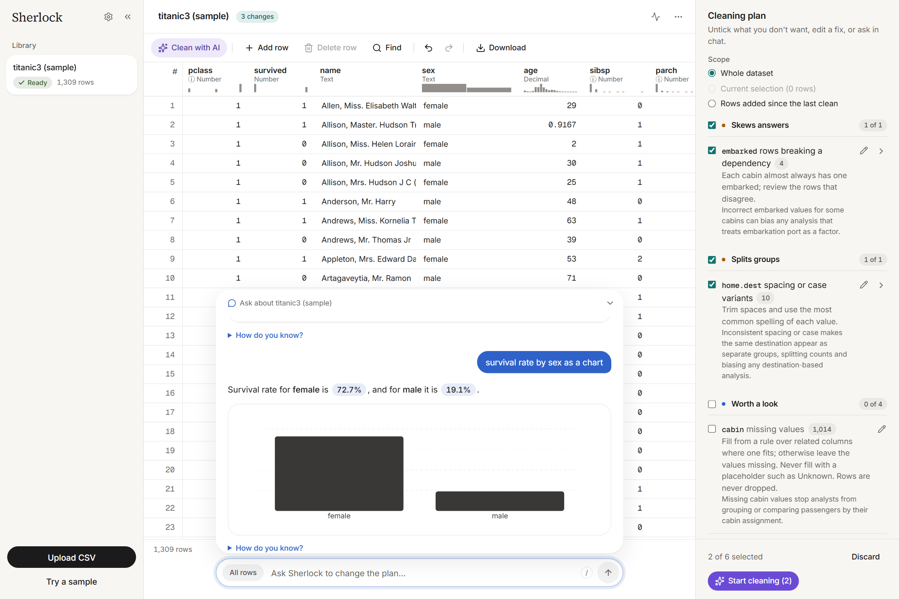 |
   | **How do you know?** shows the exact SQL that ran | Every number is a chip filled in from a query |
   | 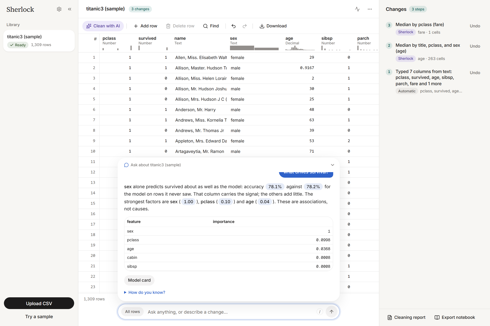 | 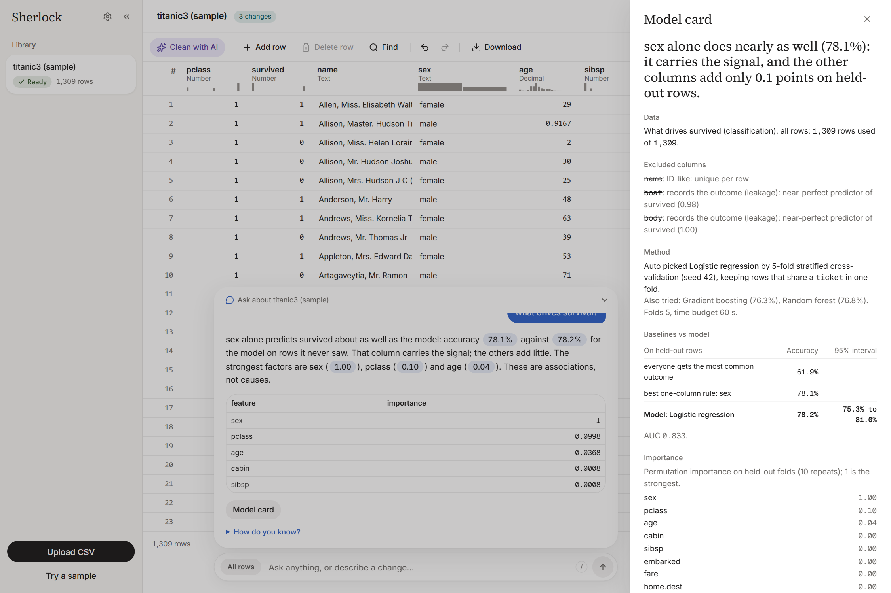 |
   | "What drives survival?" compares the model with simple baselines | The model card lists excluded columns and why |

4. Select a cell and say "set this to …", or ask for a change in your own words ("I want sex in capitals"). The change arrives as a proposal with its code, a before-and-after preview and the checks it passed. **Approve** saves it as a new version, and any analysis that read that column is marked outdated. Undo it from the Changes panel.

   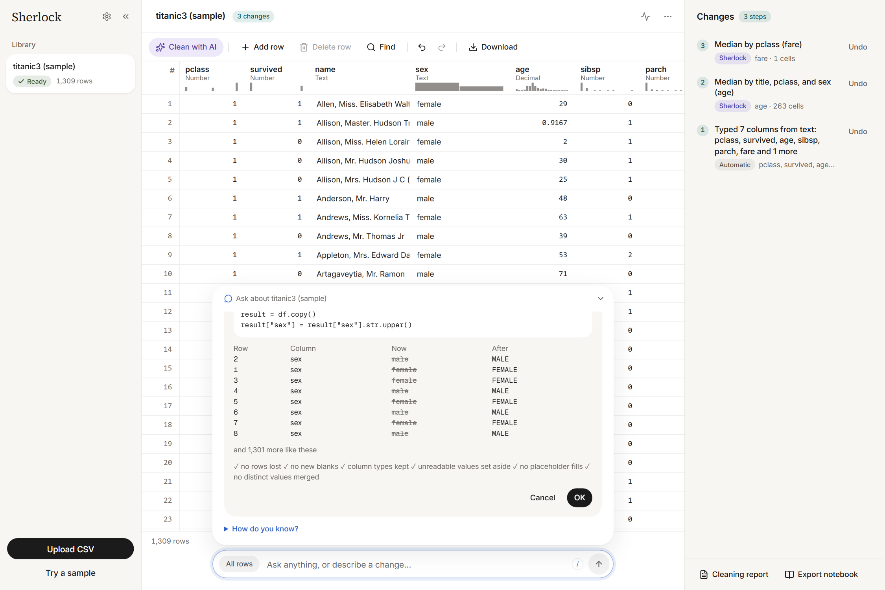

5. **Export notebook** (⋯ menu, Ctrl+Shift+E, or ask "export a notebook").
6. Drop your own CSV anywhere on the page.

   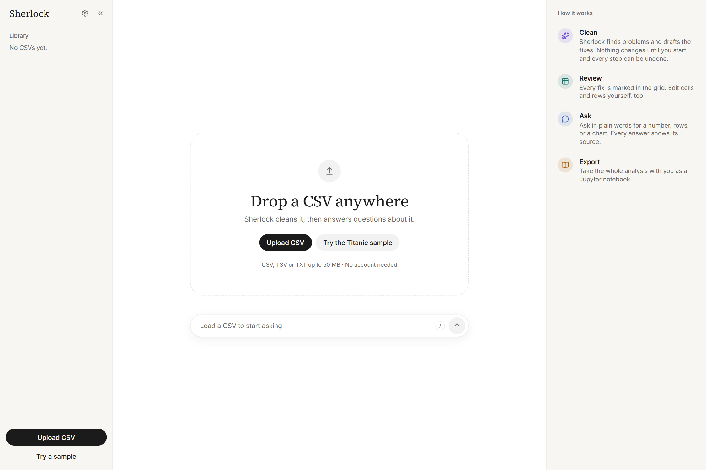

### The flow for your own file

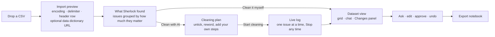

- **Import preview.** Shows how the file reads. Change the delimiter, encoding, header row or rows to skip if they're wrong, and optionally paste a data dictionary URL. Files up to 50 MB (`.csv`, `.tsv`, `.txt`).
- **The cleaning plan.** Issues are grouped as *breaks answers*, *skews answers*, *splits groups*, *worth a look* and *cosmetic*. Each one shows how many rows it affects, example values and the fix Sherlock would try.
  - Untick anything you don't want.
  - Press the pencil to say in your own words what to do instead.
  - **Add a step** to add your own.
  - ID columns and outcome columns are listed under *Marked, not changed* and are never touched.

  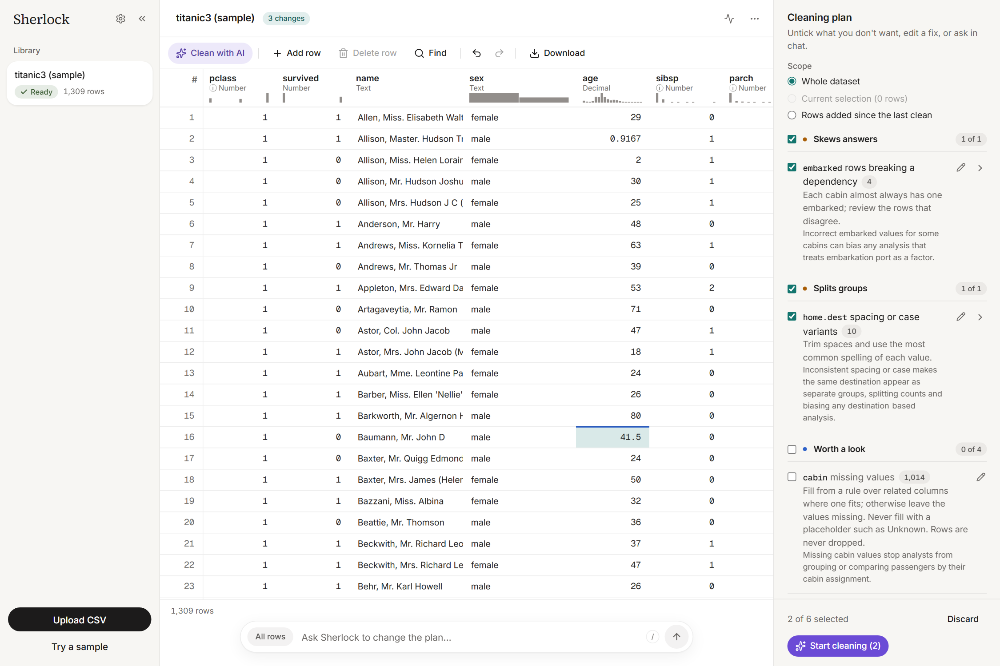

- **The live clean.** The grid is read-only while the cleaner works, and the log shows each issue as it goes. **Stop** keeps what has been committed so far.
- **The CSV tab.** Edit cells, add rows, find and sort. Edits stay in your browser until **Save changes**, which makes a new version. After saving new rows, **Clean them** opens the plan for just those rows.
- **Chat.** Answers apply to all rows, or only to the rows you selected (the chip on the left of the bar says which). An answer about rows links to them in the grid. Ambiguous questions get buttons to choose from rather than a guess.
- **Changes panel.** Every cleaning step, saved edit and approved proposal, each with its code and **Undo**.

### Everything you can do

A reference for every action in the app, grouped by where you find it.

#### Your files (the library on the left)

| Action | How |
|---|---|
| Upload a CSV | **Upload CSV** in the library, or drop a file anywhere on the page. `.csv`, `.tsv` or `.txt`, up to 50 MB. Drop one file at a time. |
| Try the sample | **Try a sample** opens the Titanic passenger list, already cleaned, with its steps and an analysis. |
| Open a file | Click it in the library. Its badge shows its state: *Reading*, *N issues*, *Looks clean*, *Cleaning N%*, *Ready* or *Failed*. |
| Rename a file | The row's menu (⋯) → **Rename**, or the dataset menu in the header. |
| Download the original | The row's menu → **Download original** (the file exactly as you uploaded it). |
| Delete a file | The row's menu or the dataset menu → **Delete**. It asks first, and **Undo** in the toast brings it back for 10 seconds. |
| Collapse or resize the library | The `«` button shrinks it to a rail of icons; drag the divider to resize it. |

#### Importing a file

| Action | How |
|---|---|
| Fix how the file reads | In the import preview, change the **Delimiter**, **Encoding**, **Header row** or **Skip rows**. The preview updates before anything uploads. |
| Link a data dictionary | Paste its address in **Data dictionary URL (optional)**. Column notes come from it first. |
| Import or cancel | **Import** uploads it; **Cancel** drops it. |
| Choose how to clean | After import: **Clean with AI** opens the cleaning plan, **Clean it myself** opens the grid. Tick **Remember my choice** to skip the question next time. |
| Pick the cleaning depth | Drag the **Cleaning depth** slider: *Surface* (single values), *Columns*, *Records* (rows against rows), *Relationships* (columns against columns), *Meaning* (the whole dataset). Deeper layers find more issues. |

#### The cleaning plan

| Action | How |
|---|---|
| Open the plan | **Clean with AI** in the CSV toolbar, at any time. |
| Choose the scope | **Whole dataset**, the rows you selected, or **Rows added since the last clean**. |
| Leave a fix out | Untick it, or untick a whole group (*Breaks answers*, *Skews answers*, *Splits groups*, *Worth a look*, *Cosmetic*) from its header. |
| Reword a fix | The pencil on a fix: say in your own words what to do instead. **Reset** puts Sherlock's wording back. |
| Add your own step | **Add a step**: pick a column (or *Rows*) and write what to do. Its pencil rewords it, × removes it. Your steps run first. |
| Add a check | **Add a check** adds a rule the data must meet (a range, allowed values, a pattern, not missing, unique…). |
| Answer the date question | When dates read both ways, choose **Day first** or **Month first** from the examples shown. |
| Change the plan from chat | With the plan open, ask "don't touch outliers" or "also trim spaces in name". |
| Start or drop it | **Start cleaning** runs it; **Discard** closes it. Nothing changes before you start. |

#### While it cleans, and after

| Action | How |
|---|---|
| Watch the clean | The live log shows each issue as it's tried, with *So far* counts and the checks on the latest step. The grid is read-only meanwhile. |
| Stop the clean | **Stop** in the log or in the Changes panel. Steps already committed are kept. |
| Keep working | A clean runs in the background: open other files in the meantime. |
| Read the report | **Cleaning report** in the Changes panel: what was fixed, flagged, kept or skipped, and why. **View full report** adds every step, the decisions, the sources and *How I worked it out* (each model call). |

#### The CSV grid: editing

| Action | How |
|---|---|
| Edit a cell | Double-click it, press Enter, or just start typing. |
| Add a row | **Add row** adds an empty row at the top. |
| Delete rows | Select cells in the rows, then **Delete row** (or **Delete N rows**). Press it again to unmark them. Deleting is undoable once saved. |
| Restore set-aside rows | Quarantined rows are dimmed with their row number struck through. Select a cell in one and press **Restore row**. |
| Save your edits | **Save changes (n)** makes a new version. Unsaved edits are kept in this browser until you save or discard. |
| Discard your edits | **Discard** (it asks first), or × on a single edit under *Not saved yet* in the Changes panel. |
| Resolve a save conflict | If the data changed while you edited, the save lists the cells both changed: pick **Keep** for yours or theirs, then **Rebase and save**. |
| Clean new rows | After saving new rows, **Clean them** in the toast opens the plan for just those rows. |

#### The CSV grid: viewing

| Action | How |
|---|---|
| Find | **Find** searches every cell; the grid shows only matching rows with a count. Esc or × closes it. |
| Sort | Click a column header: ascending, descending, off. Sorting only changes the view. |
| Read a column's meaning | Hover a header with ⓘ to see its definition and the source it was quoted from. |
| Read the marks | The legend shows *changed*, *flagged* and *unsaved* cells. |
| Go back to all rows | **Show all rows** after opening a subset from chat or a model card. |
| Download | **Download** → **CSV** (the current version) or **Notebook (.ipynb)**. |

#### Undo, redo and history (the Changes panel)

| Action | How |
|---|---|
| Undo or redo the latest changes | **Undo** / **Redo** in the toolbar (Ctrl+Z / Ctrl+Y), up to three in a row. |
| Undo any older step | **Undo** on the step in the Changes panel. An earlier step asks first, then replays the later ones so nothing else is lost. |
| See what a step did | Expand it: its code (or the list of edits), its impact and its decisions. |
| Undo right after saving | **Undo** in the toast that confirms the save. |

#### Chat: asking questions

| Action | How |
|---|---|
| Ask anything | Type in the bar below the grid (`/` focuses it, Esc closes the thread). Numbers, tables, charts, matching rows, tests, "what drives X?", "what does X mean?", questions about the outside world. |
| Ask about some rows only | Select cells in the grid first; the chip on the left of the bar says *All rows* or how many are selected. |
| See where a number came from | Click the number, or **How do you know?** for the SQL or code and the data version it ran on. **How I worked it out** lists the model calls. |
| Open rows from an answer | **Open all n rows in CSV** shows them in the grid. |
| Pick when it's unsure | An ambiguous question gets buttons to choose from. |
| Queue a follow-up | Send while an answer is running; it waits, and **Cancel** takes it back. |
| Ask how to use the app | "How do I undo a step?" answers from the help pages. |

#### Chat: changing data

Anything you can do to the file in the grid, or would do in a spreadsheet, you can ask for in words. Each change arrives as a card you read before it runs, and each is a step you can undo.

| Action | How |
|---|---|
| Change data in your own words | "Trim the spaces in name", "make fare a number", "replace S with Southampton in embarked", "fill missing age with the median". A card shows the code, the counts and a before-and-after preview. |
| Set specific cells | "Set the fare of row 9 to 30", or select a cell and say "set this to …". |
| Clean the selected rows | Select rows and ask "clean these rows"; the plan opens with them as its scope. |
| Delete rows | "Delete row 5", "delete these rows" (the selected ones), "delete the rows where age is empty", "remove the duplicates". The card shows how many go; Undo brings them back. |
| Add rows | "Add a row with name Jane Doe, sex female and age 30", "add 3 blank rows". They go at the end, shown on the card before you approve. |
| Change columns | "Add a column notes" (blank), "add total = price * quantity", "delete the column cabin", "rename home.dest to destination", "move fare to the front". |
| Set rows aside or bring them back | "Set aside the rows where …" keeps them in the file but out of answers; "bring back the set-aside rows" restores them. |
| Sort the grid | "Sort by fare descending", "clear the sort". Sorting changes the view, not the file. |
| Approve or reject | **Approve** (or OK) saves it as a new version; **Reject** (or Cancel) drops it. Nothing changes before that. |

#### Analysis and the model card

| Action | How |
|---|---|
| Find what drives a column | Ask "what drives survived?" (or any column). |
| Open the model card | The answer's **Model card** link, or ask "tell me about the model". |
| See who it got wrong | **Who did it get wrong?** opens those rows in the grid. |
| See the reproduction code | **Show the code** in the model card. |
| Re-run an outdated analysis | **Re-run** in the model card, or ask the question again. |
| Run a significance test | "Is fare significantly different between men and women?" |

#### Export

| Action | How |
|---|---|
| Export a notebook | Dataset menu (⋯) → **Export notebook**, Ctrl+Shift+E, **Download** → **Notebook**, the Changes panel, or ask "export a notebook". |
| Choose what goes in | **Include data** downloads the raw CSV beside the notebook; **Include ML runs** adds each analysis's code and tables. |
| Download the cleaned CSV | Dataset menu → **Download CSV**, or **Download** → **CSV** in the grid. |

#### Jobs, settings and layout

| Action | How |
|---|---|
| Follow background work | The jobs icon in the header lists running jobs with progress. **Cancel** stops one; a failed one has **Retry** and **Dismiss**. |
| Change appearance | The gear in the library → **Mode** (Light, Dark, System) and **Accent** colour. |
| Show or hide the chat bar | Settings → **Chat bar**: Pinned, Auto-hide (shows when you point at it) or Hidden. |
| Set what happens after upload | Settings → **After upload**: Ask me, Open the cleaning plan, or I'll clean it myself. |
| Set the default cleaning depth | Settings → **Cleaning depth**. |
| Resize the panels | Drag the dividers (or focus one and use ← →). Below 1024 px the side panels open from the header. |

#### Keyboard shortcuts

| Keys | Does |
|---|---|
| `/` | Focus the chat bar |
| `Esc` | Close the chat thread, the find bar or a dialog |
| `Enter` | Edit the selected cell; send a chat message |
| `Ctrl+Z` | Undo |
| `Ctrl+Y` or `Ctrl+Shift+Z` | Redo |
| `Ctrl+Shift+E` | Export a notebook |

Fuller user docs are in [`docs/help/`](docs/help). The chat's "how do I…" answers come from these same pages.

---

## How the agentic layer works

Sherlock runs two agents over one shared spine: the **Cleaner**, which turns a raw file into a clean version, and the **Chat agent**, which answers questions and proposes changes. Both run on NVIDIA Nemotron models through Nebius Token Factory. Both follow the same five rules:

1. **The model decides, code computes.** Detectors, verifiers, statistics, models and every number shown are code. Models choose, plan, and write code and words.
2. **Structured everything.** Every model call uses a strict JSON schema (no extra fields). The reply is validated again in code, and a failure gets one repair round with the error sent back. A second failure goes to a code fallback, never to raw model text.
3. **Code runs in a sandbox, data changes as versions.** Model-written pandas runs in an isolated subprocess with no network. A change becomes a new Parquet version plus a step you can undo. Nothing is edited in place. The Cleaner never deletes rows (it quarantines them); rows go only when you delete them, in the grid or by asking chat.
4. **Proposals, not actions.** Chat never changes data by itself. It shows a card, and you approve it. Anything you can do to a spreadsheet by hand (delete or add rows, delete, rename or move columns, set cells) you can ask for, and every one is a step you can undo.
5. **Everything is logged.** Every model call and web request is a row in `llm_calls`, and every sandbox run is a row in `sandbox_runs`. Each answer and each clean shows its calls under "How I worked it out": model, time, tokens, repairs.

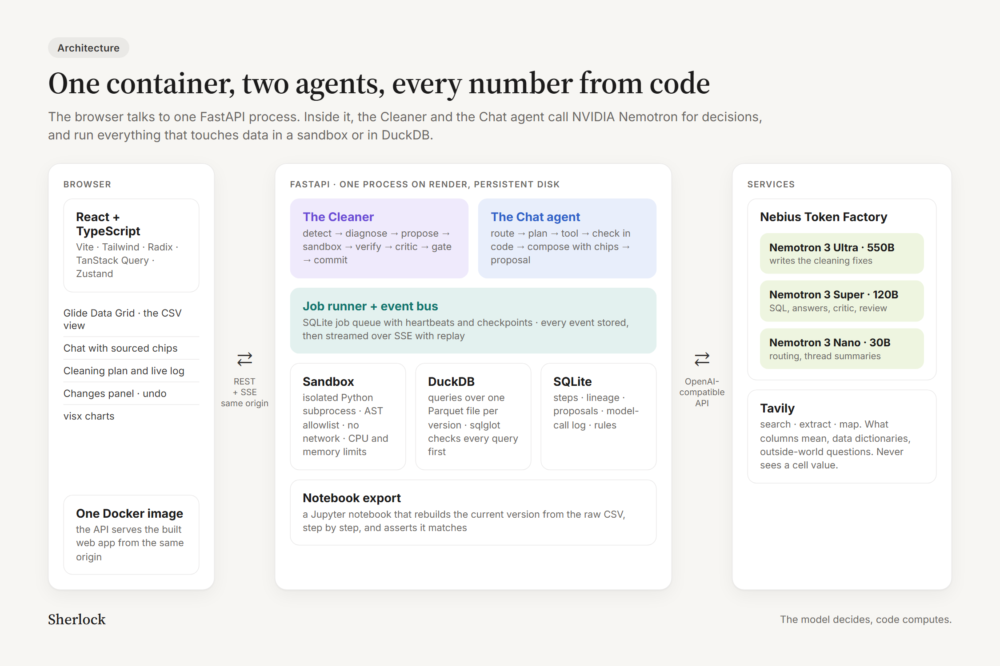

<details>
<summary>View as text</summary>

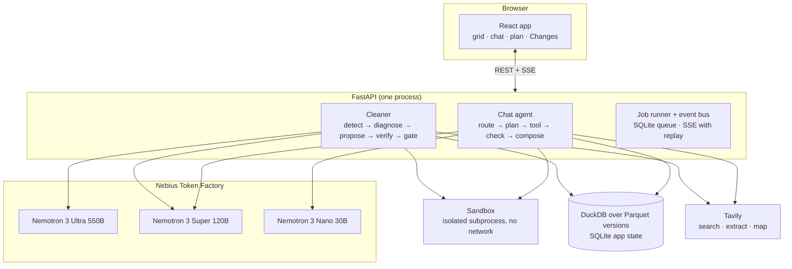

</details>

### The Cleaner

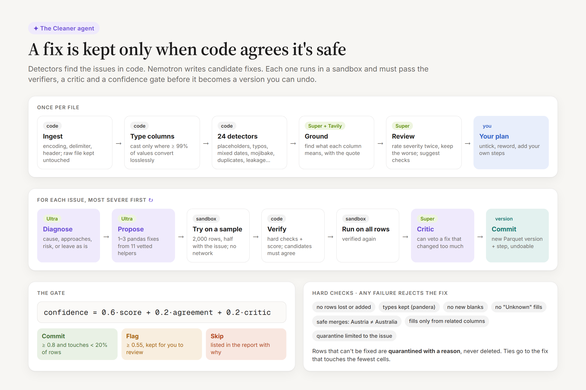

<details>
<summary>View as text</summary>

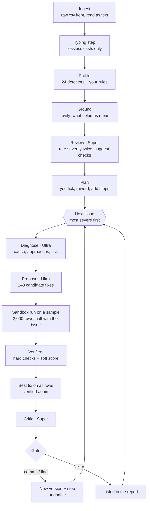

</details>

1. **Ingest** ([`ingest/`](api/sherlock/ingest)). Works out the encoding: BOM, then strict UTF-8, then charset-normalizer, with cp1252 guards for common Windows exports. DuckDB's `sniff_csv`, checked against Python's `csv.Sniffer`, finds the delimiter, header and rows to skip. Everything is read as text into `v1.parquet`, with a stable `_row_id` and a `_quarantine_reason` column. Rows with too many fields are quarantined at import.
2. **Typing** ([`profile/typing.py`](api/sherlock/profile/typing.py)). Code only, no model. A column is cast only where at least 99% of its values convert without loss. Rows whose values fail are quarantined, not coerced. This is step 1 of every dataset.
3. **Detectors** ([`cleaning/detectors/`](api/sherlock/cleaning/detectors)). 24 pure, deterministic functions, plus a `rule` detector that runs your checks. Each detector must pass a contract ([`contract.py`](api/sherlock/cleaning/contract.py)):
   - it finds its own injected damage;
   - it finds nothing on clean fixtures;
   - it runs in 2 s or less on 200k rows.

   The same injectors drive the corruption benchmark below. Operators can add Python detector packs through a `sherlock.detectors` entry point.
4. **Grounding** ([`cleaning/ground.py`](api/sherlock/cleaning/ground.py)). One Tavily search built from the column names finds a data dictionary, and Super maps its passages to columns. Columns whose names look like codes get one "what does X mean" search each, up to nine Tavily calls in all. Page text is fenced as data and never reaches the prompts that write code.
5. **Review** ([`cleaning/review.py`](api/sherlock/cleaning/review.py)).
   - Super rates every finding's level twice, and the more severe rating wins. A code floor stops it rating an issue on the target or a measure below the detector's default.
   - Super also suggests up to eight checks ("age between 0 and 120"). Code drops checks that only restate the data's own min and max. A suggestion keeps its web citation only if code finds its numbers in the quoted page.
6. **Rules** ([`cleaning/rules/`](api/sherlock/cleaning/rules)) are data, not code. There are eight kinds (`range`, `date_window`, `allowed`, `pattern`, `not_missing`, `unique`, `order`, `depends`), run by a fixed interpreter, each with an action: `quarantine`, `flag` or `fix`. You add them from the plan or chat. The model only ever suggests them.
7. **The loop** ([`cleaning/loop.py`](api/sherlock/cleaning/loop.py)) takes one issue at a time, most severe first. Some detectors are ordered ahead of others: placeholders run before impossible values, so `-999` becomes missing instead of a quarantined row.
   - **Diagnose** (Ultra): cause, two or three approaches, risk, or "leave as is". Ambiguous date orders are voted three times; with no majority Sherlock takes the conservative option, and if every date reads both ways it asks you.
   - **Propose** (Ultra): one to three candidate fixes, written only with eleven vetted helpers ([`cleaning/helpers/`](api/sherlock/cleaning/helpers)). Code adds its own fix where one is certain, such as parsing `"$1,200"`.
   - **Sandbox and verify** ([`verifiers.py`](api/sherlock/cleaning/verifiers.py)). Each candidate runs on a stratified sample.
     - *Hard checks* (any failure rejects the fix): no rows lost or added, pandera schema and types kept, no new NaNs, placeholders not filled with words, merges that can't map "Austria" to "Australia", missing values filled only when a dependency between columns recovers them, quarantine limited to the issue's own rows.
     - *Soft score*: parse rate, the detector re-run on the result, unrelated cells touched, and how much the distribution moved.
   - **Agreement.** Passing candidates that disagree on more than 1% of the cells they both change mean the issue is skipped. When candidates tie, the fix that touches the fewest cells wins.
   - **Critic** (Super) reads the full-data result and can veto it.
   - **Gate** ([`gate.py`](api/sherlock/cleaning/gate.py)). Confidence = 0.6 × score + 0.2 × agreement + 0.2 × critic.
     - Commit when confidence is at least 0.8 and the fix touches under 20% of rows.
     - Flag for review when it is at least 0.55.
     - Otherwise skip.
8. **Commit** ([`steps/`](api/sherlock/steps)). The fix becomes a new Parquet version, a step and cell-level lineage. Undo is itself a step. If the resulting chain of steps already exists as a version, that version is reused. If not, Sherlock replays the chain from the nearest version: edits by `_row_id`, typing by its SQL, fixes by re-running their code in the sandbox.

The model never counts anything. The log's numbers come from the verifier report, and a model sentence with a digit in it is dropped.

### The Chat agent

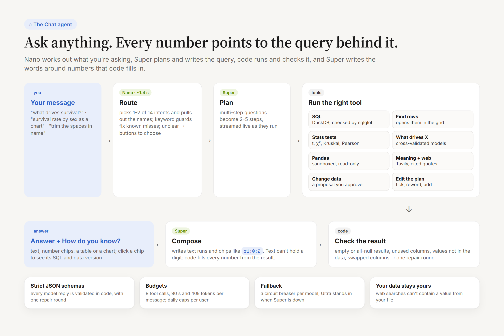

<details>
<summary>View as text</summary>

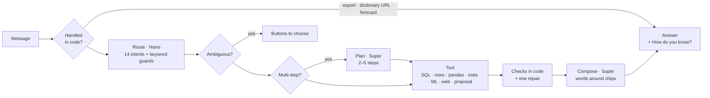

</details>

1. **Before routing.** Some requests never reach a model: export a notebook, use a data dictionary at a URL, and forecasting, which Sherlock says plainly it can't do.
2. **Route** (Nano, reasoning off, about 1.4 s). Picks one or two of 14 intents, flags ambiguity, and pulls out the column and value names. Keyword guards then correct the router. Each guard is a regex added for a routing miss seen in a live run, and the code comment says which.
3. **Resolve names** ([`agent/resolve.py`](api/sherlock/agent/resolve.py)). Columns match exactly, then by a normalized name, then fuzzily. Values match through a value index. When two candidates are close, you get buttons, and the button you press carries the resolved name forward.
4. **Plan** (Super, only for multi-step questions). Two to five steps, streamed as they run. If a step changes data, the steps after it wait until you approve the card.
5. **Use a tool:**

   | Intent | What runs |
   |---|---|
   | `ask_data` | Super writes DuckDB SQL. Code compiles it with sqlglot: one `SELECT`, no file access, and a `{{rows}}` filter injected so quarantined and unselected rows can't leak in. Runs with a 10 s watchdog. |
   | `find_rows` | Super writes a predicate, which code validates. The matching rows are saved as a selection you can open in the grid. |
   | `ask_code` | Read-only pandas (with scipy and sklearn) in the sandbox, for what SQL can't do. Also the fallback when SQL fails twice. |
   | `ask_stats` | Code picks the test by the column types: Welch t with Mann–Whitney, Kruskal–Wallis, χ² with Cramér's V, or Pearson with Spearman. Each comes with an effect size. |
   | `ask_why` | A cross-validated driver analysis: linear model, gradient boosting and random forest, against a majority baseline and the best one-column rule. Leaking and ID columns are excluded, with the reason. Permutation importance. Its metrics come from executing its own `repro.py`. On the sample it reports that sex alone does nearly as well as the model, rather than crediting the ticket number. |
   | `ask_model` | The model card. "Who did it get wrong?" opens those rows. |
   | `ask_history` | What cleaning did, from the steps (no model). |
   | `ask_meaning` | Facts about the column come from queries. What it means comes from your data dictionary, then the web (cited), then general knowledge, each labelled. |
   | `web_context` | Questions about the outside world: one Tavily search, and an answer with numbered citations and quotes. |
   | `edit_cells` · `clean_step` · `clean_selection` | Proposals. Code is dry-run in the sandbox, verified, and shown as a card with counts and a before-and-after preview. |
   | `edit_plan` | Tick, untick, reword or add steps on the open cleaning plan. |
   | `app_help` | Answers from [`docs/help/`](docs/help). |

6. **Check the result in code.** A query can run and still be wrong, so code also looks for:
   - zero rows, or a column that's all null;
   - a column you named that the query never used;
   - a `GROUP BY` column that isn't shown;
   - a literal value that isn't in the data;
   - income answered with fare (a money-kind swap);
   - a word quietly answered with an unrelated column.

   Any finding goes back to Super for one repair. The repaired query is kept only if it has fewer problems than the first.
7. **Compose** (Super). The answer is a list of runs: text, chips and labels.
   - **Text runs can't contain a digit.** A validator rejects any Unicode digit, numbers written as words, Roman numerals, causal wording and markup.
   - **A number is a chip** such as `r1:0:2`, a reference to a cell of a query result. Code fills in its value.
   - Click a chip to open its query and the data version it ran on.
   - Charts are built in code from the result.
   - If composing fails, the raw tables are shown instead.

   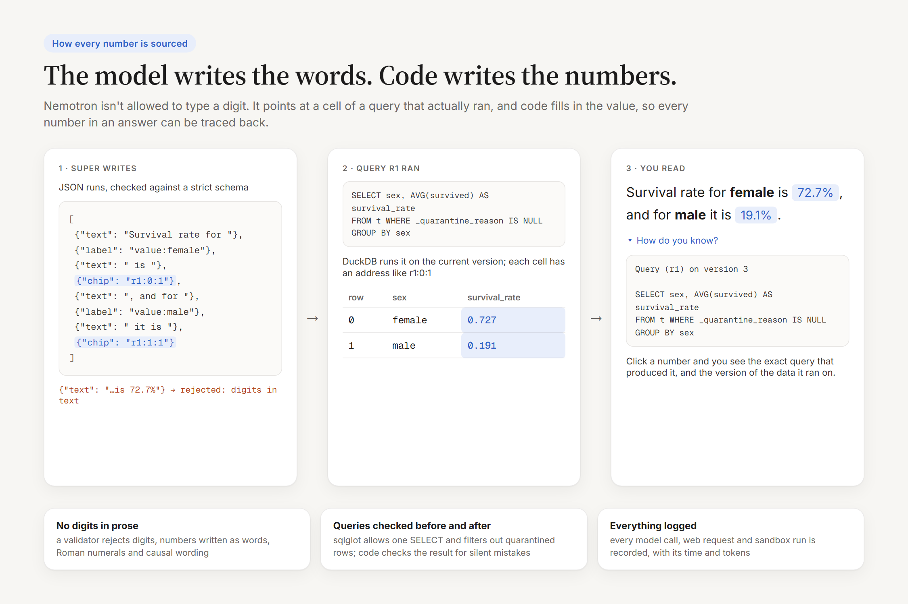

8. **Remember.** The last six messages go into the context, each tagged with the data version it was written on. Older ones are folded into a running summary by Nano.

**Guardrails on every message.**

- *Per message:* eight tool calls, 90 s and 40k tokens.
- *Rate limits:* 10 model requests a minute per user, and 20 web calls an hour.
- *Budgets:* 2M tokens a day per user, and an app-wide daily cap.
- *Models:* a circuit breaker per model role. When Super is down or short on time, the call falls back to Ultra and the fallback is recorded.
- *Prompt injection:* all file text and page text sent to a model is fenced as `<data>`, with tags inside it escaped.

### Models

Every model call goes to **NVIDIA Nemotron on Nebius Token Factory**, through the official `openai` SDK with only the base URL changed. No other model is used. The API refuses to start unless each role is an NVIDIA Nemotron ID.

| Role | Model | Used for | Median latency (live) |
|---|---|---|---|
| `large` | `nvidia/Nemotron-3-Ultra-550b-a55b` | The Cleaner's diagnose and propose; fallback for `medium` | diagnose 2.8 s, propose 6.0 s |
| `medium` | `nvidia/nemotron-3-super-120b-a12b` | Critic, severity review, suggested checks, grounding; chat's SQL, predicates, compose, plans, proposals, web answers | critic 3.8 s, SQL 4.1 s, compose 6.6 s |
| `small` | `nvidia/NVIDIA-Nemotron-3-Nano-30B-A3B` | Chat routing (reasoning off) and the thread summary | route 1.4 s |
| `embed` | none | Token Factory has no NVIDIA embedding model, so name matching uses `rapidfuzz` | |

- **Why these sizes.** Ultra writes the code that changes data, where a wrong fix costs most. Super does most of the reasoning over facts and SQL. Nano only classifies, where speed matters. In trials Nano typed chip markup into prose, so composing moved to Super.
- **Cost.** Cleaning the sample takes Ultra about 35,000 tokens. A chat answer takes 2,700–7,400 tokens (median 6,717), a fraction of a cent at Super's listed $0.30 / $0.90 per million input / output tokens.
- **Why Token Factory helped.** One OpenAI-compatible endpoint serves all three sizes, so moving a purpose between Ultra, Super and Nano is a one-word change. Strict JSON-schema decoding worked on every Nemotron model.
- **Usage log.** `uv run sherlock llm stats` (in `api/`) sums the call log by purpose and role.

### Web retrieval (Tavily)

Tavily is used for retrieval only (`search`, `extract`, `map`). Its own answer features are never used, because a non-NVIDIA model writes them. Every sentence is written by Nemotron from the pages Tavily returned, and the pages' own words are shown as quotes with their address.

- **Never sends your data.** Outbound requests hold only your words, column names and URLs you typed. Code refuses any query that contains a value from the file or a digit you didn't type. `uv run sherlock eval web` checks every request against every cell of the eval files.
- **Never mixes web numbers with your data.** A web number appears only inside its quote. It is never a chip and is never compared with your data.
- **Optional.** Set `TAVILY_API_KEY` to turn it on. Without the key, each web feature says in one line that web search isn't set up. `WEB_SEARCH=off` turns it off again. Responses are cached for 24 h.

### Jobs and streaming

Long work (profiling, review, cleaning, ML runs, exports) runs as jobs on a SQLite-backed queue. Workers claim jobs with `UPDATE … RETURNING` and send heartbeats. Each job saves checkpoints, so a run that stops on its budget lists the issues it didn't reach.

Each event is written to `job_events` and then published to the browser over Server-Sent Events. A reconnecting tab replays what it missed using `Last-Event-ID`. A chat message streams its own events (status, plan steps, the first table before the prose, proposals, sources), and a message keeps running if you close the tab.

---

## Tech stack

| Layer | What we use |
|---|---|
| **Models** | NVIDIA Nemotron 3 Ultra / Super / Nano on Nebius Token Factory, through the `openai` SDK |
| **Web retrieval** | Tavily (`tavily-python`), search, extract and map only |
| **API** | Python 3.12, FastAPI, Uvicorn, Pydantic and pydantic-settings, managed with uv |
| **Data** | DuckDB (queries, CSV sniffing), Parquet (one file per version), pandas, NumPy, SQLite (app state, job queue, event log, model-call log) |
| **SQL safety** | sqlglot, which parses and checks the model's SQL before it runs |
| **Cleaning** | pandera (schema checks), rapidfuzz (fuzzy matching), dateparser, ftfy (mojibake), charset-normalizer, regex |
| **Analysis** | scikit-learn (driver models, permutation importance), SciPy (tests), matplotlib |
| **Notebook** | nbformat; nbclient in the tests that run each export |
| **Sandbox** | A `python -I` subprocess with an AST allowlist, rlimits and no sockets. On Linux, a root daemon starts each worker as a `sandbox` user, with no network (`unshare -n`) |
| **Web app** | React 18, TypeScript, Vite, Tailwind CSS 4, Radix UI, TanStack Query, Zustand, React Router, `openapi-fetch` with types generated from the API's OpenAPI schema |
| **Grid and charts** | Glide Data Grid (canvas grid), visx and d3 with Bklit UI chart components, Motion |
| **Tests** | pytest with recorded model replies, Vitest and Testing Library, Playwright end-to-end, axe-core |
| **Hosting** | One Docker image (web build plus API) on Render, Frankfurt, with a persistent disk. `scripts/deploy.sh` targets a Nebius Serverless Endpoint, not deployed yet ([why](#nebius-alternative)) |

### Repository layout

```
api/sherlock/
  agent/       chat agent: router, planner, answerers, composer, commands, web, ML insight
  cleaning/    the Cleaner: detectors, review, plan, loop, verifiers, gate, rules, grounding
  llm/         model client (budgets, breakers, fallback, logging), schemas, repair, wording checks
  query/       SQL compile and check (sqlglot), execution (DuckDB)
  sandbox/     static check, worker, Linux sandbox daemon
  steps/       commit, undo, replay, lineage
  ml/          driver analysis, baselines, model cards, repro.py
  notebook/    notebook export and its secret scan
  ingest/ profile/ jobs/ routers/ db/ eval/ web/
web/src/       React app: shell, csv grid, chat, dataset panels, charts
docs/help/     user docs (the chat's help answers come from these)
scripts/       seed the sample, live checks, Nebius deploy
```

---

## Results

| Check | Result | Command |
|---|---|---|
| Cleaning benchmark: three clean sets damaged in known ways, the Cleaner on each with the real models | recovery 97.2% (Titanic-derived), 94.5% (sales), 74.0% (HR); harm 0.00%; row loss 0.0% | `uv run sherlock eval corruption` |
| ML planted-truth cases (no model) | 3 of 3: drivers found in order with the leak and ID excluded, noise reported as "no signal", a regression's drivers ranked | `uv run sherlock eval ml` |
| Ask anything: 61 questions over three files | **60 of 61**, **0 unsourced answers** in each of the last three live runs (2026-10-26) | `uv run sherlock eval ask` |
| Notebook (no model): export each end-to-end file and run it top to bottom in a fresh virtualenv | 5 of 5 rebuild their version after an undo with replay (107–198 s each, including installs) | `uv run sherlock eval notebook --sets all` |
| Web retrieval, live: real Nemotron and Tavily | **0 outbound requests held a cell value**; web answered 14 of 20; no answer ended in an error (2026-10-26) | `uv run sherlock eval web --live` |
| End-to-end browser flow (Playwright, recorded model replies) | sample → clean it myself → a number, a chart and a driver → approved edit → notebook → undo, 19 s | `pnpm e2e` |
| Three questions on `titanic3.csv` on the live site | about 31 s and 4 steps in all; 3 of 3 answers traceable to their SQL | |

## Known limitations

- **Ask anything misses.** The live runs score 60 of 61, and which question misses varies. Most often it's the follow-up "and for women only?", where Super returns an empty query. Keyword guards are English, so the same questions in another language go wherever Nano sends them.
- **Model variance.** Even at temperature 0, Ultra and Super vary between runs, so the same file can get different cleaning steps. Every fix is still verified and undoable.
- **Placeholders in numeric columns.** A placeholder such as `N/A` or `-999` becomes missing when its fix runs. If that fix is skipped, a domain rule quarantines the row instead.
- **Ultra's token cap.** An Ultra reply cut off at its token cap skips its issue, unless a code fix exists.
- **Files.** A header that isn't on the first row must be set in the import preview. Files up to 50 MB.
- **Identity.** Anonymous and per browser, with no recovery: clearing cookies loses access. Datasets expire after 7 days.
- **No semantic name matching.** Without an NVIDIA embedding model, "ticket price" doesn't find `fare`; you get the closest names to choose from.
- **Latency.** Answers usually take 5–15 s. Cleaning a wide messy file is slow: a 60-column file took 685 s for four steps on the live site. A sample-sized file takes about a minute.
- **Grid features not built yet:**
  - range selection, copy and paste, fill down;
  - undo of unsaved edits;
  - replace (Find is there);
  - filter row, right-click menus;
  - type-aware cell editors;
  - multi-column sort, column resize.
- **Accessibility gaps.** The slide-over panels on narrow screens don't trap focus, and some chart animations ignore reduced motion. Light and dark themes have tuned contrast, every chart has a text summary, and every control is labelled.

## What's next

**Better answers**
- Semantic column and value matching as soon as an NVIDIA embedding model is on Token Factory ("ticket price" → `fare`).
- Follow-up questions that keep their filter ("and for women only?") by editing the last query's tree instead of writing a new one.
- Routing that works in any language, by moving the keyword guards into the router's schema.
- Forecasting with honest intervals, instead of refusing.

**Faster, bigger cleaning**
- Clean independent columns in parallel. They don't depend on each other, and wide files are slow today.
- Fix placeholders before typing, so `-999` becomes missing every time.
- Files over 50 MB: run the detectors on DuckDB directly, and use a sample only where pandas runs.

**From one file to a workflow**
- Join two files, with a check of key matches before the join.
- Re-run a dataset's steps and rules on next month's file, so your cleaning becomes a pipeline and your rules become a data contract.
- Export the steps as a Python module or dbt model, as well as a notebook.
- Connect to Postgres, Google Sheets and S3.

**Sharing and accounts**
- Optional sign-in, so a workspace survives cleared cookies and lasts longer than 7 days.
- Read-only share links to an answer, its query and its version.

**Proof**
- A cold-start user test with three people who have never seen Sherlock.
- Time the same three questions answered by hand in a spreadsheet, to set against Sherlock's 31 s.
- Run `scripts/live_check.py` against the deployed site from fresh browsers.

---

## Local setup

Requirements:
- [uv](https://docs.astral.sh/uv/) (Python 3.12 is pinned in `api/.python-version`)
- Node 24 with pnpm through Corepack (`corepack enable`)
- a Nebius Token Factory API key
- optionally, Docker

```bash
cp .env.example .env        # then set LLM_API_KEY (LLM_BASE_URL and the MODEL_* IDs are filled in)
```

The API refuses to start unless `MODEL_LARGE`, `MODEL_MEDIUM` and `MODEL_SMALL` are NVIDIA Nemotron IDs (`nvidia/…nemotron…`). Web retrieval stays off until `TAVILY_API_KEY` is set.

With Docker:

```bash
docker compose up           # API on :8000, web on :5173
```

Without Docker:

```bash
cd api && uv sync && uv run uvicorn sherlock.main:app --reload --port 8000   # terminal 1
cd web && pnpm install && pnpm dev                                           # terminal 2: http://localhost:5173
```

"Try a sample" clones the seed in `api/samples/seed/titanic3/`. To rebuild it with the real models: `uv run --project api python scripts/seed_sample.py`.

## Deploy

Sherlock is hosted on **Render** as one Docker web service, built from `api/Dockerfile` with a persistent disk at `/data` and defined in [`render.yaml`](render.yaml). The service is single-instance by design: one process holds the job runner and the event bus.

1. In the Render dashboard, choose **New → Blueprint** and pick this repository.
2. Enter `LLM_API_KEY` when asked, and `TAVILY_API_KEY` to turn on web retrieval. Both are `sync: false`, so they never live in the repo.
3. Apply.

GitHub Actions can't start jobs on this account (billing), so nothing deploys on its own. Deploy by hand:

1. Run the checks locally:
   - `uv run pytest` in `api/`;
   - `pnpm test` and `pnpm build` in `web/`.
2. Push to `main`.
3. Start a **Manual Deploy** in the Render dashboard.
4. Check `/healthz`: `ok` is `true` and `commit` matches `git rev-parse --short=12 main`.

If you wait for a deploy from a script, poll `/healthz`. A loop on `/api/…` without a cookie creates a new user on every call, and after 300 in an hour every new browser on your network is turned away.

### Nebius alternative

`scripts/deploy.sh` sets the same image up as one container on a CPU-only Nebius Serverless Endpoint (`cpu-d3`, `4vcpu-16gb`), with a Nebius shared filesystem mounted at `/data` and the Token Factory key stored as a Nebius secret. It needs an active Nebius AI Cloud tenant.

We haven't deployed it there. Our new AI Cloud tenant started out suspended, so no registry, filesystem or endpoint could be created before the deadline, and the live app runs on Render instead. Inference runs on Token Factory either way.

It also needs bash, Docker, `jq`, `curl` and the [Nebius CLI](https://docs.nebius.com/cli/install). On Windows, use WSL.

```bash
./scripts/deploy.sh setup   # once: registry, /data filesystem, secret, image, endpoint
./scripts/deploy.sh         # redeploy: build, push the same tag, restart (the URL stays the same)
./scripts/deploy.sh check   # restart and confirm /data and the cookie user survive it
./scripts/deploy.sh url     # print the endpoint's public URL
```

Build and run the image locally:

```bash
docker build -f api/Dockerfile -t sherlock .
docker run -p 8080:8080 --env-file .env -e DATA_DIR=/data -e DATABASE_URL=sqlite:////data/sherlock.db -v sherlock-data:/data sherlock
```

## Tests and evals

```bash
cd api && uv run pytest     # unit and integration, with recorded model replies
cd web && pnpm test         # component tests
cd web && pnpm typecheck    # tsc -b (vitest and e2e don't type-check)
cd web && pnpm e2e          # builds the app and runs the Playwright flow against one local server
```

The evals in [Results](#results) run in `api/` and print markdown tables:

| Command | Models |
|---|---|
| `uv run sherlock eval corruption [--sets a,b]` | real (`LLM_MOCK` unset) |
| `uv run sherlock eval ask [--sets titanic3.csv]` | real |
| `uv run sherlock eval ml` | none |
| `uv run sherlock eval notebook [--sets a.csv,b.csv or all]` | none |
| `uv run sherlock eval web [--sets a.csv] [--live or --record]` | recorded replies offline; real Nemotron and Tavily with `--live` |

The sandbox's OS-isolation test needs root, so the default run skips it. To run the whole API suite as root on Linux:

```bash
docker run --rm -v "$PWD:/src:ro" -e UV_PROJECT_ENVIRONMENT=/venv ghcr.io/astral-sh/uv:python3.12-bookworm-slim sh -c 'useradd --system sandbox && cp -r /src /work && cd /work/api && rm -rf .venv && uv sync --frozen -q && chmod -R a+rX /venv /work && uv run pytest -q'
```

## License

MIT, see [LICENSE](LICENSE). Third-party licenses, the sample data's source and the copied Bklit UI components are listed in [THIRD_PARTY.md](THIRD_PARTY.md).
