# Plan: an extensible, severity-ranked Cleaner

**Status:** built, slices 1–10 (§14). The specs are PRD CLEAN-8c, CLEAN-12, CLEAN-13 and CLEAN-14 and the TRD sections they cite; this plan keeps the design's reasoning and the decisions still open (§15). Owner decisions 1–7 were taken as proposed.

**In one line:** the Cleaner's checks become a registry that can grow without limit: code detectors, installable packs, rules you write, and rules Sherlock suggests. Every finding is rated on a five-level severity scale with a one-line reason, and the plan and the queue follow that scale. Two things never change: code finds and counts every issue, and code runs and checks every fix.

**Names used below** are the code's: column roles come from `profile/infer.py` (`measure`, `free_text`, `id`, …), and "the target" means a column in the DataCard's `target_candidates`.

---

## 1. Why

The work answers two problems found in the same place, the cleaning plan.

### 1.1 The plan doesn't say what matters

A run often reads like "16 issues found, 4 fixed". The five clean runs in the local `api/data/sherlock.db` (mostly Titanic) break down like this:

| Outcome | Findings | Share |
|---|---|---|
| Fixed (committed) | 17 | 31% |
| Fixed, flagged for review | 3 | 5% |
| Never changed by design: leakage and ID columns, and every other finding on those columns | 21 | 38% |
| "Left as is": Ultra judged the values to be real (missing cabins, an old passenger's age) | 10 | 18% |
| Real failures: no candidate passed the checks | 3 | 5% |
| Not reached | 1 | 2% |
| **Total** | **55** | |

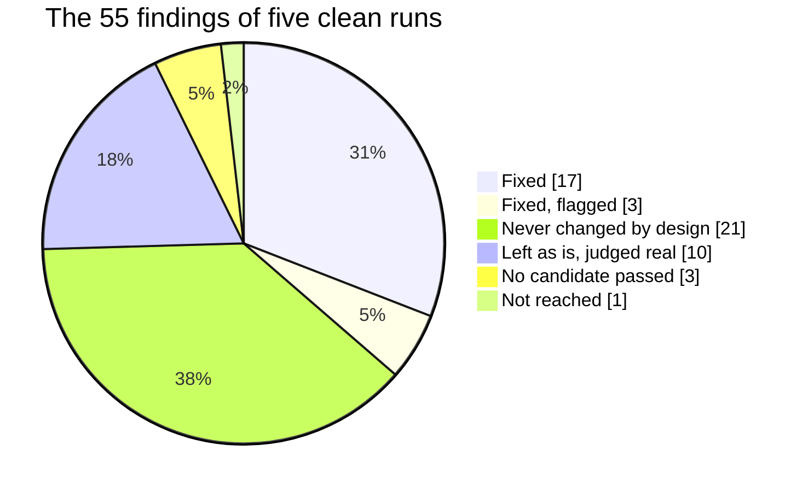

Only about 5% are real failures, yet today's report (PRD CLEAN-6) puts 34 of the 55 under one word, "skipped". The gap has two causes:

- **The plan treats observations as fixes.** "Missing values" and "outliers" sit next to "fare stored as text" as ticked fixes, although the detectors' own planned actions say "otherwise leave the values missing" and "they stay in unless they're errors".
- **The ranking measures size, not impact.** Severity = share of rows affected × detector weight (TRD §7.1 step 4). Three impossible ages in the target score almost zero, and a typo in the target ranks the same as a typo in a notes column.

The same runs, counted the way §10.3 proposes:

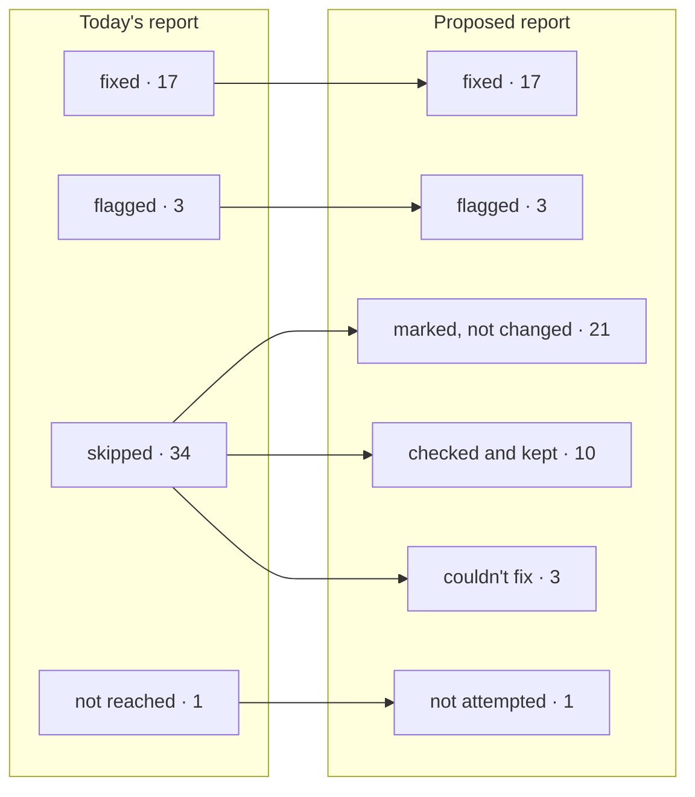

### 1.2 The set of checks can't grow

Every detector's facts are hard-coded in nine places. Adding one, or renaming one, means editing all of them, and missing one fails quietly: a raw id shows in the UI, an issue lands in the wrong section, or the queue order breaks.

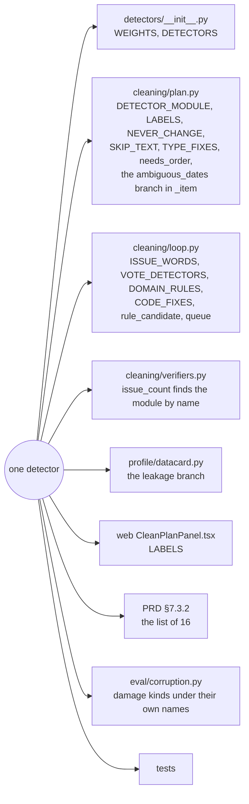

The copies have already drifted: `plan.LABELS` says "mixed types" and "broken dependencies" where `loop.ISSUE_WORDS` says "values of another type" and "rows breaking a dependency". Only six of the sixteen detectors have a damage kind in the corruption eval (`money`, `sentinel`, `case`, `typo`, `mojibake` and the date kinds), so ten are never measured for recovery.

### 1.3 Goals

1. **Severity you can act on.** Before pressing Start, you see which findings would change answers, which are probably fine, and why.
2. **A budget spent where it matters.** The Cleaner's 20 attempts and 300 s (`CLEAN_MAX_STEPS`, `CLEAN_MAX_SECONDS`) go to the most severe issues first.
3. **An honest report:** fixed · flagged · checked and kept · couldn't fix · not attempted, with "marked, not changed" apart, instead of one large "skipped".
4. **One file per detector.** A new detector is one module, or one rule, with no edits anywhere else, and it is rated, grouped, labelled and queued correctly from its own spec.
5. **Growth without Python.** You can add a check in plain terms, and Sherlock can suggest checks the built-ins miss.
6. **The same safety bar for everything.** Every detector, built in or added, passes one shared test suite and is measured by the corruption benchmark.

### 1.4 Non-goals

- The model never scans rows, counts anything or executes code. Detectors and rules are evaluated by code (Rule 2).
- The Cleaner's loop is unchanged: diagnose, propose, sandbox, nine hard checks, critic, gate, `commit_step`.
- Uploaded code never runs in the API process. Python packs are installed by the operator; users add rules, which are data.
- Leakage and ID columns are not rated: they stay under "Marked, not changed".
- No change to the P0 scope or the cut order (plan §5).

---

## 2. The design in one picture

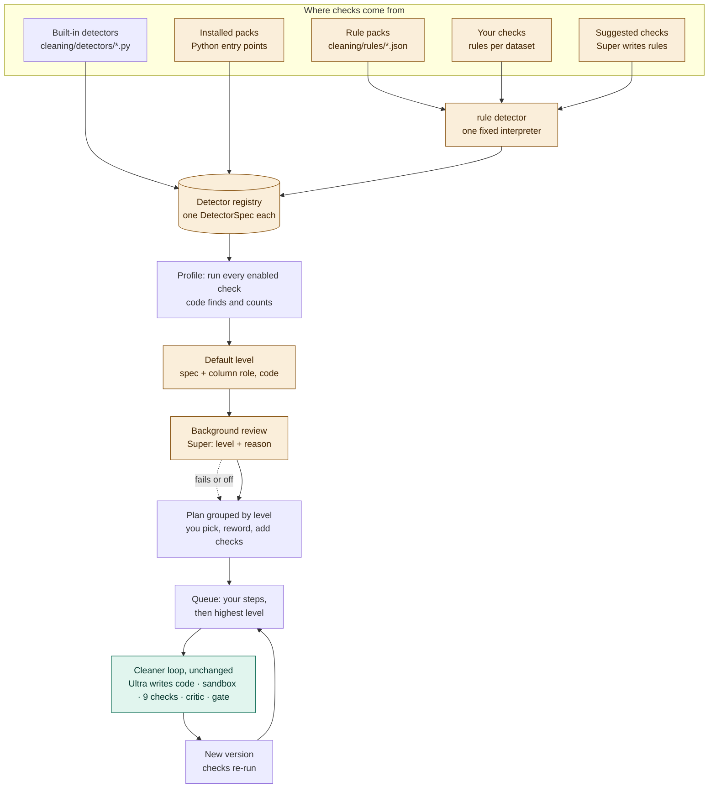

| Step | Who | Today | After |
|---|---|---|---|
| Know which checks exist | code | 16 names in nine places | **the registry: one spec per check, from code, packs or rules** |
| Find and count issues | code | 16 detectors | **every enabled check, including rules** |
| Decide what never changes | code | leakage and ID names | **`spec.never_change`** |
| Rank issues | code | share × weight | **a default level from the spec and the column's role; Super adjusts it with a reason** |
| Pick what to run | you | everything ticked | **grouped by level; "Worth a look" and suggestions start unticked; "Add a check"** |
| Write fix code | Ultra | same | same |
| Run, verify, commit / flag / skip | code | same | same |

The registry (§3) and the severity scale (§5) are the two halves of the design. The registry tells the rest of the app what each check is: its label, its group, its behaviour and its default level. The review then adjusts that level for this file, by looking at the column's role and the examples.

---

## 3. The detector registry

### 3.1 `DetectorSpec`

Each detector is one module that exports a spec. Every fact that is now scattered across the nine places becomes a field.

```python
@dataclass(frozen=True)
class DetectorSpec:
    id: str                      # stable; stored as issues.detector ("sentinels")
    version: int                 # bump when what it finds changes; stored on the issue
    label: str                   # plain words for the plan, the log and the prompts ("placeholder values");
                                 # replaces plan.LABELS, loop.ISSUE_WORDS and the web's LABELS
    description: str             # one sentence for the catalog and the rating prompt
    group: str                   # plan section when levels are off: types | missing | text | records | outliers | other
    weight: float                # code severity weight, 0–1 (TRD §7.1 step 4); orders issues within a level
    default_level: Level | None  # breaks | skews | splits | check | cosmetic (§5.2); None with never_change
    scope: Scope                 # "column" | "rows" | "columns" (a pair or more)
    applies_to: frozenset[str]   # column types it reads; empty = all
    detect: Callable[[Frame], list[Finding]]

    # Behaviour that is a special case in loop.py and plan.py today:
    never_change: str | None = None      # reason shown under "Marked, not changed" (leakage, IDs); not rated
    skip_text: str | None = None         # the log's detail for an issue on a column it marks ("left as is")
    marks_column: str | None = None      # the DataCard list it fills (leakage_candidates); id_columns come
                                         # from the column role, not from id_candidates
    type_fix: bool = False               # allowed on an ID column (sentinels, numbers_as_text)
    domain_rule: bool = False            # violations quarantined, never guessed; low confidence flags
    vote: bool = False                   # an ambiguous order settled by a three-sample majority
    code_fix: Callable[[dict], Candidate | None] | None = None      # a fix code writes without the model, from the issue:
                                         # numbers_as_text's parse, impossible_values' quarantine (today rule_candidate)
    runs_before: tuple[str, ...] = ()    # same-column order (sentinels before impossible_values)
    plan_extras: Callable[[dict], dict] | None = None        # extra plan fields from the issue (dates read both ways, needs_order)

    # Quality gates (§9):
    injector: Callable[[pd.DataFrame, Random], Damage] | None = None   # benchmark damage of this kind
    clean_fixture: Callable[[], pd.DataFrame] | None = None            # data it must find nothing in
    enabled_by_default: bool = True
```

The `Finding` type (`detectors/base.py`) keeps its shape: detector, column, count, proposal, at most five examples, details.

### 3.2 The registry (`cleaning/registry.py`)

- **`register(*specs)`** takes specs together, all or nothing, so a `runs_before` may name a spec of the same call. It refuses: a duplicate id; an unknown group or level; a weight outside 0–1; a `runs_before` that names an unknown id or creates a cycle.
- **Lookups:** `all()`, `enabled(settings)`, `get(id)`, `label(id)`. `get` returns an "unknown detector" spec for issue rows written by a pack that has since been removed, so old versions still display.
- **`load_plugins()`** runs once at startup. It reads Python entry points in the group `sherlock.detectors`, which a pack declares in its own `pyproject.toml`:

  ```toml
  [project.entry-points."sherlock.detectors"]
  finance = "sherlock_finance.detectors:SPECS"
  ```

- **Config** (TRD §10):
  - `DETECTORS_OFF`: ids to skip.
  - `DETECTOR_PLUGINS`: `off` | `all` | an allowlist of pack names (**Owner**, §15).
  - `RULE_MAX_S` (§4.3).
- **`/healthz`** lists the loaded packs and their versions, as it lists the model ids, and any pack that was refused.

What happens at startup:

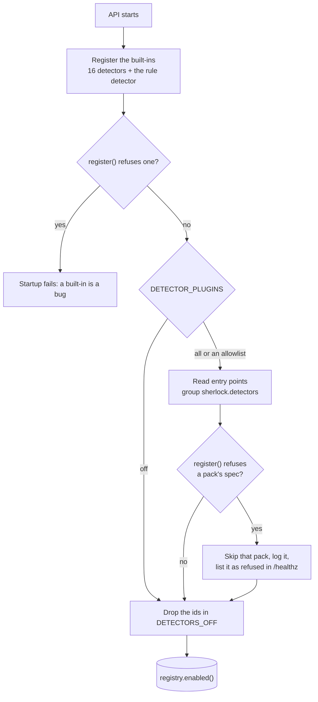

### 3.3 What reads the registry instead of a name

| Today | After |
|---|---|
| `detectors.WEIGHTS[...]`, `DETECTORS` tuple | `spec.weight`, `registry.enabled()` |
| `plan.DETECTOR_MODULE`, `LABELS`, `NEVER_CHANGE`, `SKIP_TEXT`, `TYPE_FIXES` | `spec.group`, `spec.label`, `spec.never_change`, `spec.type_fix` |
| `loop.ISSUE_WORDS`, `VOTE_DETECTORS`, `DOMAIN_RULES`, `CODE_FIXES` | `spec.label`, `spec.vote`, `spec.domain_rule`, `spec.code_fix` |
| `loop.rule_candidate` (reads `impossible_values`' details) | `impossible_values`' `spec.code_fix` |
| `loop.queue`'s `sentinels` special case | a general same-column order from `spec.runs_before` (§7) |
| `plan._item`'s `ambiguous_dates` branch, `plan.needs_order` | `spec.plan_extras` |
| `datacard.py`'s `leakage` branch | `spec.marks_column` |
| `verifiers.issue_count`'s module lookup | `registry.get(id).detect` |
| the web's `LABELS` | `GET /detectors` (§10.2) |
| `eval/corruption.py`'s damage kinds | `spec.injector` (§9) |

---

## 4. Checks without code: rules

Most useful future checks are not new algorithms. They are constraints: a range, allowed values, a pattern, an order between two columns. One built-in detector, `rule`, interprets them. A rule is data, so you, a rule pack or the model can add one safely: a fixed interpreter runs it, never arbitrary code.

### 4.1 Rule kinds

| Kind | Parameters | Finds | Default level |
|---|---|---|---|
| `range` | `min`, `max` (either may be open) | numbers outside the range | skews |
| `date_window` | `earliest`, `latest` | dates outside the window | skews |
| `allowed` | `values` (at most 200) | values not in the list, ignoring case and spacing | splits |
| `pattern` | `regex` (anchored, ≤ 200 characters, no backreferences) | text that doesn't match the pattern | splits |
| `not_missing` | — | missing values in a column that must be filled | check |
| `unique` | — | repeated values in a column that must be unique | skews |
| `order` | `left`, `right`, `op` (`<`, `<=`) | rows where the two columns are in the wrong order (start after end) | skews |
| `depends` | `from`, `to` | rows where the same `from` value has a different `to` value | check |

A rule also has an `action`:
- `quarantine`: the domain-rule handling, as `impossible_values` has today;
- `flag`: kept and marked for review;
- `fix`: the Cleaner's normal diagnose and propose, given the rule as the issue.

Each rule becomes its own plan item and issue key, `rule:<rule_id>|<column>`, so it is counted, rated and queued like any other finding.

### 4.2 Where rules come from

| Source | Stored in | Columns named by | Starts | Generic? (Rule 4) |
|---|---|---|---|---|
| **Rule pack** (shipped) | `cleaning/rules/*.json` | type, role or name words ("a column whose name says age") | ticked | must be; the hygiene test checks it |
| **Your checks** | `detector_rules`, per dataset | the dataset's own columns | ticked | yours, so they may name columns |
| **Suggested checks** (§6.3) | `detector_rules`, status `suggested` | the dataset's own columns | unticked | per dataset |

The existing `impossible_values` word lists (`NON_NEGATIVE`, ages, percentages, dates) move into a rule pack in the last slice (§14). That also fixes the open problem that its name matching has no word boundaries (`account_balance`, `average_temp`).

### 4.3 A rule's life

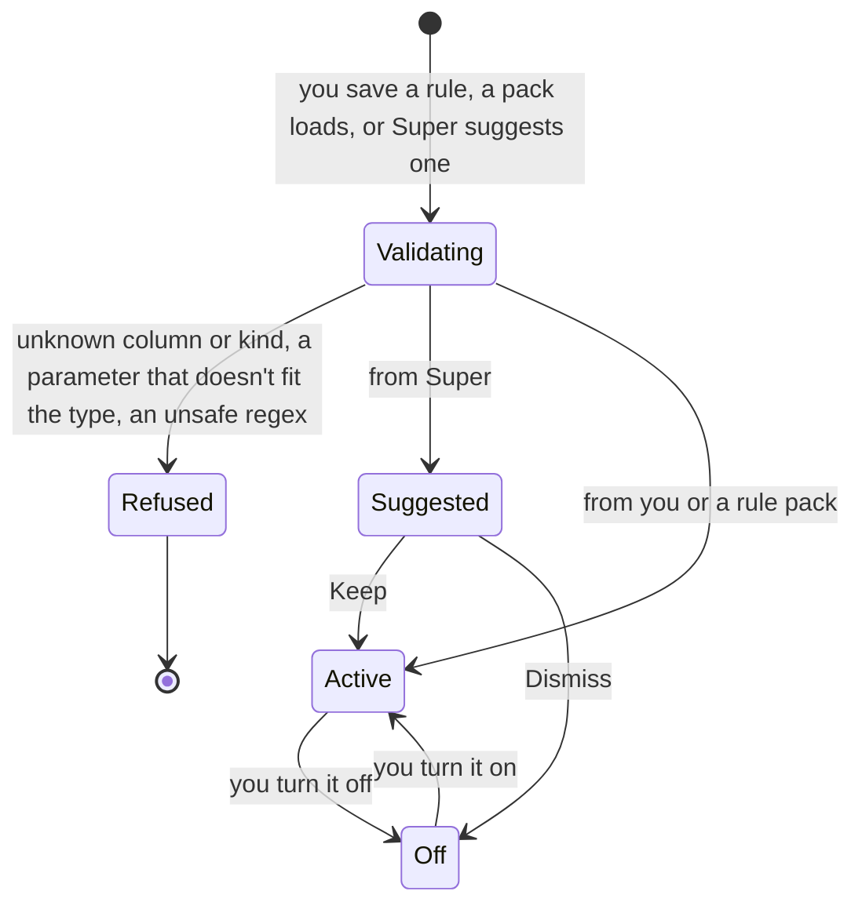

- An `active` rule runs on every new version of its dataset, like a built-in detector.
- A dismissed suggestion stays as an `off` row, so the same kind on the same column is never suggested again.
- A rule's count is shown as soon as it is saved, because code runs it on the current version.

### 4.4 Interpreter safety

- **Vectorised only:** pandas operations, never `eval`, `query` or per-row Python. A rule that runs past `RULE_MAX_S` (2 s) on the profile's frame is stopped and listed as "This check took too long".
- **Regex limits:** a regex is checked when it's saved (anchored, no backreferences or nested quantifiers, length capped) and runs with a match timeout through the `regex` package (**Owner**, §15).
- **Parameter checks:** parameters must fit the column's type. A `range` on a text column is refused when the rule is saved, not at run time.

---

## 5. Severity

### 5.1 The scale

The five levels are adapted from incident severity levels to what an issue does to an analysis. A level is a category, not a computed number, so it fits Rule 2. In the schema it is an enum of words, not digits.

| Level | Enum | Plan heading | Meaning | Typical findings (placeholders, not one file's columns) |
|---|---|---|---|---|
| SEV-1 | `breaks` | Breaks answers | Answers or models would be wrong | numbers stored as text or mixed types in the target or a measure |
| SEV-2 | `skews` | Skews answers | Answers would be biased | placeholders such as `-999` pulling an average; impossible values; duplicate records that inflate counts; start after end |
| SEV-3 | `splits` | Splits groups | Groups would be split or mislabeled | `"<value>"` and `"<Value> "` showing as two bars; near-duplicate categories; garbled characters in a category |
| SEV-4 | `check` | Worth a look | Probably real; worth a look | outliers; rows that break a usual dependency; missing values with no rule to recover them |
| SEV-5 | `cosmetic` | Cosmetic | Doesn't change any answer | spacing or case in a free-text column |

### 5.2 Default levels: code, on every spec

Each spec carries a `default_level`. Code adjusts it for the column, and the result is the item's **default level**:

- **one level more severe** when the column is the target or has role `measure`;
- **one level less severe** when it has role `free_text`, never below `cosmetic`;
- a finding over several columns (`cross_column`) takes the most important role among them;
- a finding over whole rows (`duplicates`) takes no adjustment;
- a spec whose default is `check` takes no adjustment either: an outlier or a missing value is an observation whatever its column, so it stays in "Worth a look".

The default level is what the plan shows when the review fails, times out, is over budget, returns an invalid reply or is turned off, and what an issue gets when a fix exposes it in the middle of a run (§7).

| Built-in detector | `default_level` | On the target / a measure | On free text |
|---|---|---|---|
| `mixed_types`, `numbers_as_text` | skews | breaks | splits |
| `sentinels`, `impossible_values`, `unit_mixes`, `ambiguous_dates`, `cross_column` | skews | breaks | splits |
| `duplicates` | skews | (rows: no adjustment) | — |
| `near_duplicate_categories`, `whitespace_case`, `mojibake` | splits | skews | cosmetic |
| `missing`, `outliers`, `functional_dependency` | check | check | check |
| `leakage`, `id_candidates` | not rated (`never_change`) | — | — |

Rules take theirs from their kind (§4.1), and a pack's detectors from their own specs. A new check is therefore rated sensibly even with the model off.

### 5.3 How an item gets its level

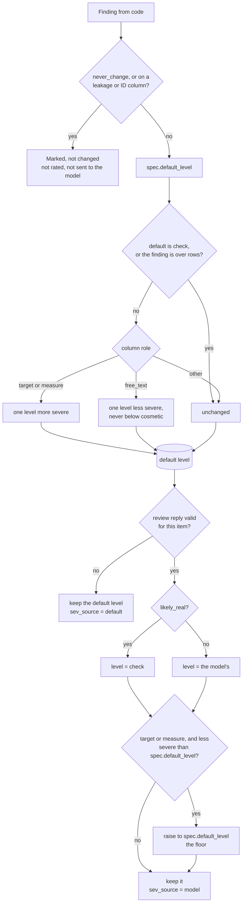

The floor is the spec's own default, not the adjusted one, so on the target the model can lower a level by one step at most, and it can never lower it into "Worth a look" unless the spec starts there. The floor wins over `likely_real` (**Owner**, §15).

### 5.4 What the levels drive

| Where | Effect |
|---|---|
| **Plan** | grouped under the five headings, highest first; "Worth a look" starts unticked (**Owner**, §15) |
| **Queue** | your steps first, then by level, then by code severity within a level (§7) |
| **Budget** | when the 20 attempts or 300 s run out, the issues not reached are the least severe |
| **Report** | each item shows its level; a "Worth a look" item that ends "left as is" counts as **checked and kept**, not as a failure |

---

## 6. The background review: rating and suggestions

### 6.1 One job, two calls, after profiling

Opening a plan must stay instant: today `plan.create` runs inside the request with no model call. So both model calls run in one background job, `review_issues` (`jobs/review.py`). The profile job queues it after each upload, and `POST …/clean/plan` queues it when the version has no review yet and none is queued or running.

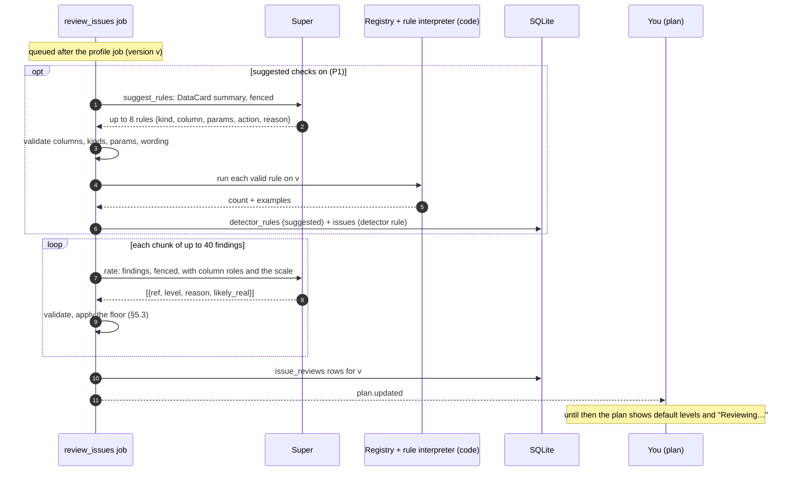

- **Suggestions come first** so the rating sees them and rates them like any other finding.
- **Stored apart from `issues`.** `profile/service.py` deletes and rewrites a version's `issues` rows each time it profiles it, so ratings live in `issue_reviews`, keyed by version and issue key (§10.1). Versions never change (Rule 3), so a rating stays valid until the detector's `version` changes.
- **One review per version.** Reopening a plan or merging a stale one (`plan.merge`) reads the stored ratings and doesn't call the model again. A failed review is recorded as `default` and not retried for that version.
- **Not on every commit.** `commit_step` re-profiles each new version inline. During a run the queue uses the plan's levels and the default levels (§7), so a run adds no model calls.
- **Budget.** Both calls count against `JOB_TOKEN_BUDGET`; over budget, the remaining items keep their default levels and the clean run keeps its own budget.

The plan's `review` field moves like this:

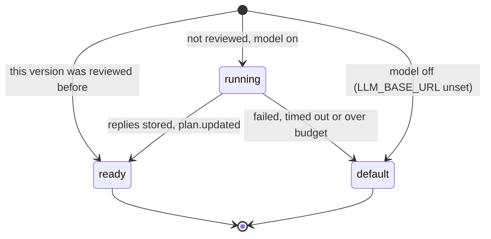

**Your edits win.** The review only changes items you haven't touched: an item you ticked, unticked or reworded keeps your choice, and the review may still move it to another group. If you press Start before the review finishes, the run uses the plan as it is at that moment; a review that finishes later is stored for the report but doesn't change the running queue.

### 6.2 The rating call

- **Role and purpose:** `medium`, purpose `rate`, temperature 0, reasoning on (only `route` may turn it off, TRD §3.5).
- **Chunks:** at most 40 findings per call, most severe by code first, so a wide file doesn't overflow the reply. Each chunk is rated twice and each finding keeps the more severe level. A chunk that fails both times leaves its items at their default levels; the others still apply.
- **Prompt** (`cleaning/prompts/rate.txt`): the scale, then one line per finding inside a `<data>` block:
  - its ref (`f1`, `f2`…, as `edit_plan` does);
  - the spec's label and description;
  - the column's role and type;
  - code's count and share;
  - up to five examples;
  - the planned action, or the rule's text.

  Column names, examples and the file name go through `llm.text.fence`. Prompt examples are placeholders (Rule 4). A new detector or rule needs no prompt change, since its spec supplies the words.
- **Schema** (`llm/schemas.py`, `Ratings`):

  ```json
  { "ratings": [ { "ref": "f1", "level": "breaks|skews|splits|check|cosmetic",
                   "reason": "<one sentence, no digits>", "likely_real": false } ] }
  ```

- **Validation** (code):
  - every ref of the chunk appears exactly once, with no unknown refs;
  - `reason` passes `llm.wording.wording_problem` and `llm.text.has_digits` is false, so every number in the plan comes from code;
  - `likely_real` and the floor apply as in §5.3.

  A failing reply gets the client's one repair call, then the defaults. A reason that fails on its own is dropped, and the item keeps the model's level.
- **Cost:** about 2–6 s and a few thousand tokens for a typical file of 10–30 findings. Each call is an ordinary `llm_calls` row, so receipts and `sherlock llm stats` show it.

### 6.3 Suggested checks (P1)

The model writes a rule; code evaluates it. This is how the set of checks grows on its own without breaking Rule 2. The model already writes SQL that code runs, and here it writes rules that code runs.

- **Input:** the DataCard summary chat already uses (TRD §8.1): column names, types, roles, missing share, range and top values. Never raw rows.
- **Output** (`RuleSuggestions`, purpose `suggest_rules`, `medium`): at most eight rules `{kind, column, params, action, reason}`, validated against the columns and kinds (§4.1). A suggestion that repeats an `off` rule, an active rule or a built-in finding on the same column is dropped.
- **Thresholds are suggestions,** like a literal in SQL the model writes. The plan shows them as an editable rule labelled "suggested by Sherlock", never as a fact. The count beside it is code's (**Owner**, §15).
- **Shown unticked** under "Suggested checks", with their level and reason. Keep makes a rule `active` for this dataset. Dismiss makes it `off`.

---

## 7. Queue order during a run

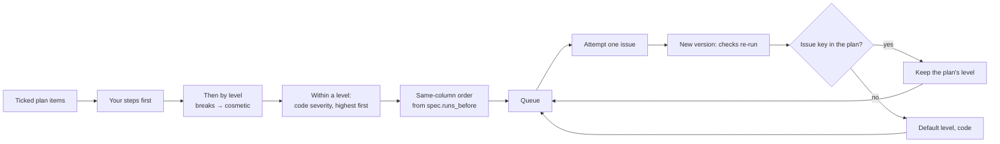

- **Your steps stay first,** as today (`loop.USER_SEVERITY`).
- **`runs_before` replaces the sentinel special case.** An item whose spec says `runs_before = ("impossible_values",)` moves up to just before the first `impossible_values` item on the same column, never down. So a column's placeholders run before its domain rule whatever their levels, and `-999` becomes a missing value instead of quarantining the row. A pack or rule can declare its own order the same way.
- **No model call during the run.** A new issue that a fix exposes takes its default level.

A worked example, with placeholder columns:

| Plan item | Level | Code severity | Queue position |
|---|---|---|---|
| Your step: trim spaces in `<name>` | — | — | 1 (your steps first) |
| `impossible_values` in `<measure>` | breaks (skews, +1 for a measure) | 0.03 | 3 |
| `sentinels` in `<measure>` | breaks (skews, +1) | 0.02 | 2 (`runs_before`, although its severity is lower) |
| `near_duplicate_categories` in `<category>` | splits | 0.10 | 4 |
| `outliers` in `<measure>` | check | 0.01 | not queued: starts unticked |

---

## 8. The trust boundary

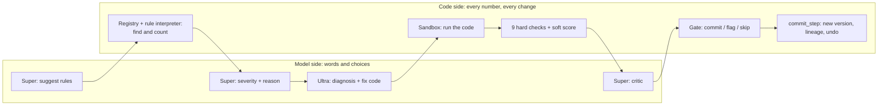

- **A suggested rule** only proposes a check. Code counts it, and you decide whether to keep it.
- **A rating** only moves an item within the plan and sets whether it starts ticked. It can't stop the checks from running, commit a fix that fails them, change a count, lower a target finding below its floor, or touch a leakage or ID column.
- **A failed fix is still skipped:** a `breaks` item whose fix fails the checks is skipped with its reason, as today, and counted as "couldn't fix".

---

## 9. The same bar for every check

A check is code that judges data, so a bad one quietly produces bad plans. Instead of relying on reviewers to remember what to look at, one suite runs on every spec in the registry, including installed packs and the rule interpreter. It runs in CI and at pack install time (`uv run sherlock detectors check`).

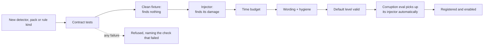

| Check | Rule |
|---|---|
| Metadata | id unique and snake_case; group and `default_level` valid; weight 0–1; label and description present |
| Determinism | the same frame twice gives the same findings |
| Purity | the frame and its columns are unchanged after `detect` |
| Finding shape | count > 0, the column exists (or is None for row scope), at most five examples, details JSON-serialisable |
| Clean data | `clean_fixture()` gives no findings (a shared clean fixture of every column type is the default) |
| Finds its damage | `injector` damage of N cells gives a finding with count ≥ N. Required for every rated detector; `never_change` detectors (leakage, IDs) need a fixture they must find instead |
| Resolvable | re-running on the injector's clean values finds nothing, so the verifier's "share of the issue gone" works |
| Time | ≤ 2 s on a 200,000-row frame of the types it applies to. The suite also reports the total for every enabled check on 500,000 rows, which must stay inside the Profile budget (≤ 60 s for a 50 MB file, TRD §13) |
| Wording | label, description and proposal pass `wording_problem` and carry no sample column names (`test_prompt_hygiene.py`) |
| Generic | no column name from any sample file in the module's constants or a shipped rule pack (Rule 4) |

`sherlock eval corruption` builds its damage from `registry.all()` injectors. The six damage kinds of `eval/corruption.py` move onto the specs they test (`money` → `numbers_as_text`, `sentinel` → `sentinels`, `case` → `whitespace_case`, `typo` → `near_duplicate_categories`, `mojibake` → `mojibake`, the dates written one way → `ambiguous_dates`; the unambiguous day-first dates → `mixed_types`, which is the detector that finds them), and the other rated detectors get one in slice 2. Each case's plan then names a detector id instead of a kind, so a new check is measured for recovery, wrong values, harm and row loss with no new eval code. The eval also checks the ratings (§13).

---

## 10. Data, API and screens

### 10.1 Schema (`docs/05-BACKEND-SCHEMA.md`)

- **Migration `009_issue_review.sql`:**
  - `issues` (§2.8) gains `detector_version INTEGER`, so `plan.merge` can tell a changed finding from a changed detector, and `skip_kind TEXT`, written by `loop._skip` beside `skip_reason`: `kept_by_design | left_as_is | failed_checks | gate | disagreement | budget`. The report's counts come from `skip_kind`, not from parsing the reason.
  - New table `issue_reviews`:

    ```sql
    CREATE TABLE issue_reviews (
      dataset_id       TEXT NOT NULL,
      version          INTEGER NOT NULL,
      key              TEXT NOT NULL,          -- detector|column, as plan.key
      detector_version INTEGER NOT NULL,
      sev              TEXT NOT NULL,          -- breaks|skews|splits|check|cosmetic
      sev_reason       TEXT,
      sev_source       TEXT NOT NULL,          -- model|default
      likely_real      INTEGER NOT NULL DEFAULT 0,
      created_at       TEXT NOT NULL,
      PRIMARY KEY (dataset_id, version, key)
    );
    ```

- **Migration `010_detector_rules.sql`:**

  ```sql
  CREATE TABLE detector_rules (
    id          TEXT PRIMARY KEY,          -- rul_…
    user_id     TEXT NOT NULL,
    dataset_id  TEXT,                       -- NULL = the user's rule for every dataset (P2)
    source      TEXT NOT NULL,              -- user | suggested | pack
    status      TEXT NOT NULL,              -- active | suggested | off
    spec_json   TEXT NOT NULL,              -- {kind, column, params, action, reason}
    created_at  TEXT NOT NULL,
    updated_at  TEXT NOT NULL
  );
  ```

- **`clean_plans.items_json`** (§2.21) is JSON, so plan items gain `sev`, `sev_reason`, `sev_source`, `likely_real`, `touched` and `rule_id` without a migration.
- **Retention:** both new tables are purged with their dataset (schema §6).

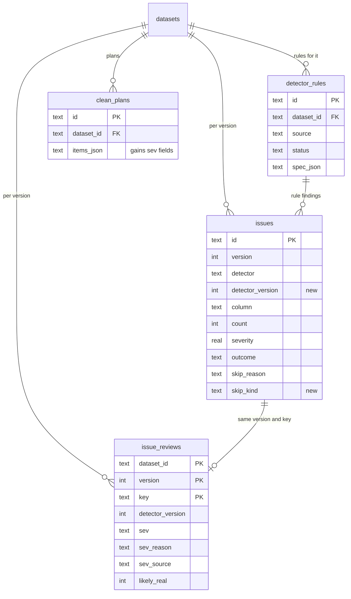

### 10.2 API (TRD §4.4)

| Method | Path | Body | Returns |
|---|---|---|---|
| GET | `/detectors` | — | `{ detectors: [{ id, label, description, group, default_level, source }] }`, `source` being `builtin`, `pack` or `rule` |
| POST | `/datasets/{id}/clean/plan` | as today | `CleanPlan`: items gain the level fields, and the plan gains `review: "ready" \| "running" \| "default"` |
| GET | `/datasets/{id}/rules` | — | `{ rules: Rule[] }` |
| POST | `/datasets/{id}/rules` | `{ kind, column, params, action }` | `Rule` with its count on the current version (validated; `422` names the bad field) |
| PATCH | `/rules/{rid}` | `{ status?, params?, action? }` | `Rule` |

New plan ops (`PlanOp`, `plan.apply_ops`):
- `tick_level` and `untick_level`, like `tick_module`;
- `add_rule`;
- `keep_suggestion` and `dismiss_suggestion`.

### 10.3 Screens (App Flow §4.1, §5)

- **Plan panel**, groups in this order:
  1. **Your steps**
  2. **Breaks answers**
  3. **Skews answers**
  4. **Splits groups**
  5. **Worth a look**
  6. **Cosmetic**
  7. **Suggested checks**
  8. **Marked, not changed**
- **Each item shows:**
  - the label from `GET /detectors` (the web's `LABELS` map goes away);
  - code's count and examples;
  - the planned fix or the rule;
  - the model's reason in muted text, and "(default level)" when the fallback set it.
- **No per-item badges.** The group heading carries the level, keeping to the UI brief's "no badges on every element" (UIUX §10).
- **While the review is running,** the plan shows default levels and "Reviewing…", then refreshes on `plan.updated`.
- **"Add a check"** in the plan: pick a column, a kind with its parameters, and an action. The count appears as soon as the rule is saved.

A wireframe of the panel (placeholders, not a sample file):

```text
┌ Cleaning plan ──────────────────────────────────────── Reviewing… ┐
│ Your steps                                                          │
│   [x] Trim spaces in <name>                                         │
│ Breaks answers                                         [tick all]   │
│   [x] numbers stored as text in <measure>               212 rows    │
│       Averages of <measure> can't be computed until it is parsed.   │
│ Skews answers                                                       │
│   [x] placeholder values in <measure>                    38 rows    │
│       Placeholders would pull the average down.                     │
│ Splits groups                                                       │
│   [x] spacing or case variants in <category>             57 rows    │
│ Worth a look                                           [tick all]   │
│   [ ] outliers in <measure>                              12 rows    │
│       These look like real large values.     (default level)        │
│ Cosmetic                                                            │
│   [x] spacing or case variants in <notes>                 9 rows    │
│ Suggested checks                                                    │
│   [ ] <measure> is never below zero   suggested by Sherlock          │
│       3 rows break it.                          [Keep] [Dismiss]    │
│ Marked, not changed                                                 │
│   <id column> looks like an ID column, so it is left as is          │
│                                                     + Add a check    │
└─────────────────────────────────────────────────────────────────────┘
```

The counts are code's; the muted reasons are the model's and carry no digits.

- **Chat** (`agent/actions.py` `edit_plan`): plan lines include the level and reason. "Skip the cosmetic ones", "do everything that breaks answers" and "flag rows where `<column>` is below zero" become plan edits.
- **Report** (PRD CLEAN-6): **fixed · flagged · checked and kept · couldn't fix · not attempted**, with **marked, not changed** listed apart. Each count lists its items with their level and `skip_reason`.

How an item ends up in the report:

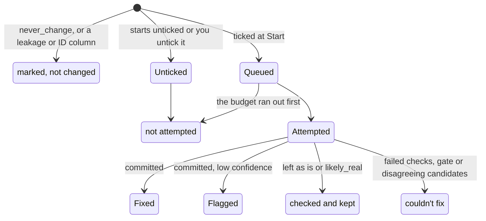

| Report line | From `issues` |
|---|---|
| fixed | `outcome = fixed` |
| flagged | `outcome = flagged` |
| checked and kept | `skip_kind = left_as_is`, or the review set `likely_real` |
| couldn't fix | `skip_kind` in `failed_checks`, `gate`, `disagreement` |
| not attempted | `skip_kind = budget`, or the item was unticked |
| marked, not changed | `skip_kind = kept_by_design` |

---

## 11. Where the code goes

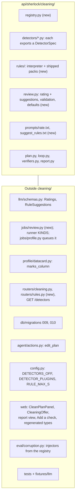

| Area | Files | Change |
|---|---|---|
| Registry | `cleaning/registry.py` (new); `detectors/*.py`, `detectors/__init__.py` | one spec per detector; registration, plugins, lookups |
| Rules | `cleaning/rules/` (new): `interpreter.py`, `kinds.py`, `*.json` packs | the `rule` detector and its kinds |
| Review | `cleaning/review.py` (new), `prompts/rate.txt`, `prompts/suggest_rules.txt` | rating, suggestions, validation, default levels |
| Cleaner | `plan.py`, `loop.py`, `verifiers.py`, `report.py` | read specs; group and queue by level; `runs_before`; `skip_kind`; new report counts |
| LLM | `llm/schemas.py` | `Ratings`, `RuleSuggestions` |
| Jobs | `jobs/review.py` (new), `jobs/runner.py` (`KINDS`), `jobs/profile.py` | the background review |
| Profile | `profile/datacard.py`, `profile/service.py` | `marks_column` instead of the leakage branch; `detector_version` on issue rows |
| API | `routers/cleaning.py`, `routers/rules.py` (new), `/detectors` | §10.2 |
| DB | `db/migrations/009_issue_review.sql`, `010_detector_rules.sql`; the purge | §10.1 |
| Chat | `agent/actions.py` | level-aware plan lines; `tick_level`, `add_rule` |
| Config | `config.py`, `.env.example`, `render.yaml` | `DETECTORS_OFF`, `DETECTOR_PLUGINS`, `RULE_MAX_S` |
| Web | `CleanPlanPanel.tsx`, `CleaningOffer.tsx`, the cleaning report view, `api/schema.d.ts`, `api/types.ts` | §10.3 |
| Eval | `eval/corruption.py`, `eval/synthetic.py` | injectors from the registry; rating checks |
| Tests | `tests/test_detector_contract.py`, `test_cleaning_review.py`, `test_rules.py` (new); `test_cleaner.py`, `test_cleaning_units.py`, `test_chat_actions.py`, `test_prompt_hygiene.py`; `fixtures/llm/cleaner_review.json` | §13 |
| Developer guide | `api/sherlock/cleaning/detectors/README.md` (new); example pack in `api/samples/detector_pack/` | how to write a detector, a rule pack or a pack |

---

## 12. Docs to update in the same commits (Rule 1)

| Doc | Section | Change |
|---|---|---|
| PRD | §7.3.2 | "the built-in detectors" plus the registry; the list of 16 stays as the built-in set |
| PRD | new **CLEAN-8c** | severity levels with reasons, the default levels, the floor, what starts ticked |
| PRD | CLEAN-6 | the report's new counts |
| PRD | new **CLEAN-12** | the registry and catalog: one spec per check; labels come from the catalog |
| PRD | new **CLEAN-13** | your checks: rule kinds, actions, counts from code |
| PRD | new **CLEAN-14** | suggested checks: model-written rules, evaluated by code, approved by you |
| TRD | §3.3 | job kind `review_issues` |
| TRD | §3.5 | purposes `rate` and `suggest_rules` |
| TRD | §4.4 | `/detectors`, `/rules`, plan fields and ops |
| TRD | §7.1 step 4, §7.2 | the registry, `DetectorSpec`, the rule detector, the queue by level, `runs_before`, `skip_kind` |
| TRD | §10 | `DETECTORS_OFF`, `DETECTOR_PLUGINS`, `RULE_MAX_S` |
| TRD | §14 | the contract suite, the review tests, the registry-driven corruption eval |
| TRD | §15 | packs are installed by the operator only; rules are data run by a fixed interpreter |
| Schema | §2.8, §2.21, new tables `issue_reviews` and `detector_rules`, migrations list, §6 purge | §10.1 |
| App Flow | §4.1, §5 | groups, "Reviewing…", Add a check, Suggested checks, report counts |
| UI brief | plan panel and report | group headings, muted reasons, the Add a check form, the suggested group, no per-item badges |
| Implementation plan | build order | the slices in §14 |

What each slice built and the eval results it got go in its commit message, not in a doc (Rule 5).

---

## 13. How we verify it

- **Contract suite** (`test_detector_contract.py`): every rule in §9, parametrised over `registry.all()`. Slice 1's proof is that the 16 built-ins give identical findings before and after.
- **Registry:**
  - duplicate ids, bad groups, levels and weights, and `runs_before` cycles are refused;
  - a refused pack is skipped and listed in `/healthz`; a refused built-in fails startup;
  - a removed pack's old issues still display;
  - `DETECTORS_OFF` disables a detector.
- **Rules** (`test_rules.py`):
  - each kind finds what its table says;
  - a bad parameter is refused when saved;
  - a slow rule stops at `RULE_MAX_S`;
  - a hostile regex is refused or times out;
  - a rule's issue is counted, rated and queued like any finding;
  - a dismissed suggestion is not suggested again.
- **Default levels:** the role adjustments of §5.2, including several columns and whole rows.
- **Review** (`test_cleaning_review.py`, recorded replies, no network):
  - a valid rating sets levels and reasons;
  - a missing, duplicate or unknown ref gets a repair, then the defaults, for that chunk only;
  - a reason with digits or causal wording is dropped;
  - `likely_real` sets `check`, and the floor still holds on the target;
  - leakage and ID findings are never sent;
  - ratings survive a re-profile of the same version, and a changed `detector_version` drops them;
  - an item you touched keeps its tick after the review;
  - Start before the review finishes runs on the plan as it was;
  - suggestions are validated, run by code and stored unticked;
  - with `LLM_BASE_URL` unset, every item gets its default level and the plan still opens.
- **Queue:**
  - your steps first, then by level, then by code severity;
  - `runs_before` holds even when the later detector is rated higher;
  - an issue a fix exposes gets its default level;
  - the budget ends on the least severe.
- **Report:** each `skip_kind` lands on the line of §10.3.
- **Prompt hygiene:** `test_prompt_hygiene.py` sends the malicious file through the `rate` and `suggest_rules` builders, and shipped rule packs carry no sample column names.
- **API and e2e:**
  - opening a plan returns at once with `review: "running"` or `"default"`, and `plan.updated` follows;
  - Playwright covers:
    - the eight groups;
    - unticking "Worth a look";
    - Add a check, with its count shown;
    - Keep and Dismiss on a suggestion;
    - the new report counts.
- **Live eval** (`sherlock eval corruption`, Nemotron):
  - **Rating:** every injected damage in the target or a measure is rated at least as severe as its detector's own default (the floor, §5.3), and damage to free text is rated `splits` or lower.
  - **Report honesty:** "couldn't fix" equals the real failures.
  - **Unchanged:** recovery, Wrong 0, harm 0 and row loss 0 stay at or above the last run's.
  - **Stable:** the same file reviewed twice gives the same levels.

---

## 14. Build order

Each slice is verified (`uv run pytest`, `corepack pnpm test`, `corepack pnpm typecheck`, `corepack pnpm e2e` where the UI changes, `sherlock eval corruption`) and writes its own specs: the rows of §12 for what it builds, in the same commit as its code (Rule 1). No slice writes specs for a later one.

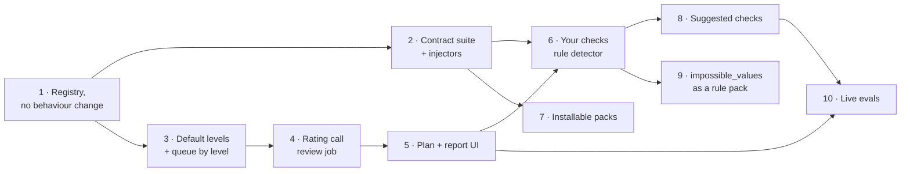

1. **Registry, no behaviour change.**
   - Add `DetectorSpec` and `registry.py`, and give the 16 built-ins their specs (with `default_level`, unused yet).
   - Move every hard-coded map in §3.3 to the registry, merging `plan.LABELS` and `loop.ISSUE_WORDS` into `spec.label`; add `GET /detectors`; switch the web's labels to it.
   - Proof: the full test suite and the corruption eval with `LLM_MOCK` give identical results.
2. **Contract suite and injectors.** `test_detector_contract.py`, an injector and clean fixture per built-in, and the corruption eval reading injectors from the registry. Fix any built-in that fails the contract.
3. **Default levels and queue by level, no model.** Migration 009 (`detector_version`, `skip_kind`, `issue_reviews`); plan items with `sev_source: default`; grouping by level; `loop.queue` by level with `runs_before`; the report from `skip_kind`. Shipped alone, this already gives the target-column boost and the honest report.
4. **The rating call.** `Ratings`, `rate.txt`, `review.py` with chunks, validation, the floor and the fallback, the `review_issues` job, and `plan.updated`.
5. **Plan and report UI.** The eight groups, reasons, "Reviewing…", `tick_level` in the panel and in chat, and the new report lines.
6. **Your checks.** The rule interpreter and kinds, migration 010, the `/rules` API, `add_rule`, and "Add a check".
7. **Installable packs.** Entry points, `DETECTOR_PLUGINS`, `DETECTORS_OFF`, `/healthz` listing, `sherlock detectors check`, the developer guide and the example pack.
8. **Suggested checks (P1).** `suggest_rules` inside the review job, validation, the "Suggested checks" group, Keep and Dismiss.
9. **Built-in rule packs.** Move the `impossible_values` word lists into `cleaning/rules/packs/plausible_values.json` with whole-word matching; the detector keeps its id and reads its domains from the pack; the contract suite and the corruption eval prove recovery is unchanged.
10. **Live evals.** The rating, report-honesty and stability checks against Nemotron.

Slices 2 and 3 only need slice 1, so they can be built in parallel, as can slices 6 and 7.

---

## 15. Risks and open decisions

### 15.1 Owner decisions

| # | Question | Proposal |
|---|---|---|
| 1 | Priority of CLEAN-8c, 12, 13, 14 | After the hackathon: P1 for 8c, 12 and 13; P2 for 14 (suggested checks). Nothing here changes the P0 scope or the cut order (plan §5). |
| 2 | Should "Worth a look" start unticked? | Yes: these are the findings that end "left as is" today. You can tick them, or the whole group from chat. |
| 3 | Should "Cosmetic" start ticked? | Yes: case and spacing fixes are cheap, safe and almost always pass the checks. |
| 4 | Are installed packs allowed in production? | `DETECTOR_PLUGINS=off` by default, an allowlist when on. Packs run in the API process with its permissions, so only the operator installs them. |
| 5 | Are model-suggested thresholds compatible with Rule 2? | Yes, as with SQL literals: a threshold is a rule parameter you see and can edit, and the count is code's. |
| 6 | Add the `regex` package for timed matching? | Yes, so a pattern can't hang the profile job. Otherwise, drop the `pattern` kind. |
| 7 | When the model says `likely_real` on the target, which wins? | The floor (§5.3): the item stays at the spec's default level and ticked. The Cleaner's own diagnosis can still leave the values as they are, which the report counts as "checked and kept". |

### 15.1a Decided after the live benchmark

| # | Question | Decision |
|---|---|---|
| 8 | The floor (§5.3) is the spec's own default, so on the target the model may lower a level by one step; the live rating check (§13) expected `breaks` or `skews` there. | §5.3's floor stands; the check now expects at least the spec's own default on the target or a measure. |
| 9 | The same version reviewed twice gave a different level for at least one finding at temperature 0. | Each chunk is rated twice and the more severe level kept (§6.2), so one lighter reading can't move a finding down. Two readings narrow the differences without removing them, so a finding identical to one already rated for the dataset (same key, detector version, count, examples, role and type) reuses that rating with no model call: a re-review of a file gives the same levels, and an untouched issue keeps its level on the next version. |

### 15.2 Risks

| Risk | Mitigation |
|---|---|
| The model rates a serious issue low | The floor on the target and measures (§5.3); the item stays ticked unless it lands in `check`. |
| The model rates something real as `breaks` | The checks and the gate are unchanged, so a wrong fix still can't commit. A bad rating changes the order, not the data. |
| Levels change between visits | One review per version, temperature 0, stored in `issue_reviews`. |
| A re-profile wipes the ratings | They live in `issue_reviews`, not on the `issues` rows the profile rewrites. |
| The review overwrites your choices | It only changes items you haven't touched, and never the plan of a run that has started (§6.1). |
| A wide file overflows the rating reply | Chunks of 40; a failed chunk falls back on its own. |
| Prompt injection through a column name or a cell | Fenced like every prompt; covered by the hygiene test; a reason with markup fails the wording check. |
| A slow or noisy check degrades every upload | The time budget in the contract suite, `RULE_MAX_S`, and `DETECTORS_OFF` without a deploy. |
| A pack removed after its issues were stored | `registry.get` returns an "unknown detector" spec, so old plans and reports still display. |
| A detector change makes old plans misleading | `issues.detector_version`; `plan.merge` re-runs items whose detector version changed. |
| Too many plan items as checks grow | Severity groups keep the important ones on top; suggestions start unticked. |
| Overlapping checks flag the same cells | `spec.scope` and the issue key; the contract suite reports pairs of checks that flag the same cells on the shared fixture. |
| Extra wait before the plan | None: the plan opens with default levels and updates itself. |

---

## 16. Built: the plan against the code

Each requirement of §3–§13, where it lives and what proves it (`api/` paths; web under `web/src`).

| § | Requirement | Code | Proven by |
|---|---|---|---|
| 3.1 | `DetectorSpec` with every field (and `skip_text`, `found_fixture`, `fixture_rules`, `source`) | `cleaning/detectors/base.py`; a `SPEC` per module | `test_registry.py`, `test_detector_contract.py` |
| 3.2 | `register` refusals (duplicate, group, level, scope, weight, `runs_before` unknown or cycle), all or nothing | `cleaning/registry.py` | `test_registry.py` (incl. a refused built-in stopping startup) |
| 3.2 | `all`, `enabled`, `get` (unknown spec), `label`; packs by entry point; `DETECTORS_OFF`, `DETECTOR_PLUGINS`, `RULE_MAX_S`; `/healthz` lists packs | `registry.configure`, `config.py`, `main.py` | `test_detector_packs.py`, `test_registry.py` |
| 3.3 | Every hard-coded map read from the registry, labels merged | `plan.py`, `loop.py`, `verifiers.py`, `datacard.py`, `actions.py`, `useDetectorLabel` | slice 1's identical eval; `test_cleaner_gaps.py` |
| 4.1 | Eight rule kinds, three actions, key `rule:<id>\|<column>` | `cleaning/rules/kinds.py`, `interpreter.py` | `test_rules.py` (each kind) |
| 4.2 | Shipped packs (`formats`, run by the rule detector; `plausible_values`, read by impossible_values), your checks, suggested checks, checks for every dataset (P2) | `rules/packs/`, `rules/store.py`, `review.suggest`, migration 012 | `test_rules.py`, `test_cleaning_review.py`, `test_detectors.py` |
| 4.3 | Refused when saved; suggested → kept or dismissed; active runs every version; count at once | `rules/service.py`, `routers/rules.py` | `test_rules.py`, `test_cleaning_review.py`, e2e `plan.spec.ts` |
| 4.4 | Vectorised; `RULE_MAX_S`; anchored, length-capped pattern with no back-reference or nested repeat, matched with a timeout; parameters fit the type | `rules/kinds.py`, `interpreter.run` | `test_rules.py` (slow rule, hostile patterns, bad parameters) |
| 5.1–5.2 | Five levels; default level from spec and role | `cleaning/levels.py` | `test_cleaning_levels.py` |
| 5.3 | `likely_real`; the floor at the spec's own default | `review.rated`, `review.floor` | `test_cleaning_review.py`; live rating check |
| 5.4 | Plan grouped by level, "Worth a look" unticked; queue by level; budget ends on the least severe; report lines | `plan.py`, `loop.queue`, `loop._not_reached`, `report.py`, `CleanPlanPanel.tsx`, `CleaningReport.tsx` | `test_cleaning_levels.py`, `test_cleaner.py` (budget), vitest, e2e |
| 6.1 | Background `review_issues` job, queued after profile and by `POST …/clean/plan`; one review per version, reused for identical findings; your edits win; a started plan unchanged; `review` field | `jobs/review.py`, `cleaning/review.py`, `plan.reviewed` | `test_cleaning_review.py`; "Reviewing…" in vitest and e2e |
| 6.2 | Rating call: `medium`, `rate`, temperature 0, reasoning on, chunks of 40, two readings, fenced prompt, refs checked with one repair, reasons without digits | `cleaning/review.py`, `prompts/rate.txt`, `Ratings` | `test_cleaning_review.py`, `test_prompt_hygiene.py` |
| 6.3 | Suggested checks from the DataCard summary, validated, deduplicated, counted by code, rated, editable, Keep and Dismiss | `review.suggest`, `prompts/suggest_rules.txt`, `RuleSuggestions`, `SuggestedChecks` | `test_cleaning_review.py`, vitest, e2e |
| 7 | Your steps first, then level, then severity; `runs_before`; no model call in a run | `loop.queue` | `test_cleaning_levels.py`, `test_cleaner_gaps.py` |
| 13 | Live recovery holds: a picked date order and code's own parse settle what the data allows (`order_candidate`, `code_fix_settles`), code's merge of the pairs beats a fix that only sets rows aside (`merge_candidate`, `sets_aside_only`), and the critic can't skip code's parse of values the column shows read one way (`gate.overrule_parse`) | `cleaning/loop.py`, `gate.py`, `numbers_as_text.reads_one_way`, `near_duplicate_categories.merge_candidate` | `test_cleaner_checks.py`, `test_cleaner_gaps.py`, `test_cleaner.py` |
| 8 | Code finds, counts and runs everything; the model picks levels, reasons and rules | the above | `test_rules.py`, `test_cleaning_review.py` |
| 9 | Contract: metadata, clean data, finds its damage, determinism, purity, shape, types, 2 s on 200,000 rows, the total on 500,000, overlaps, wording, generic | `cleaning/contract.py`, `sherlock detectors check` | `test_detector_contract.py`; the command |
| 9 | Corruption eval builds damage from the injectors | `eval/corruption.py`, `registry.injector` | identical damage for all 8 sets |
| 10.1 | Migrations 009–012: `detector_version`, `skip_kind`, `issue_reviews` (+ fingerprint), `detector_rules` (+ every dataset) | `db/migrations/` | `test_db.py` |
| 10.2 | `GET /detectors`, `/rules` (GET, POST, PATCH), plan fields and ops (`tick_level`, `untick_level`, `add_rule`, `keep_suggestion`, `dismiss_suggestion`) | `routers/cleaning.py`, `routers/rules.py` | `test_registry.py`, `test_rules.py`, `test_cleaning_review.py`, `test_openapi.py` |
| 10.3 | Panel groups, reasons, "(default level)", "Reviewing…", Add a check, Suggested checks; chat's level lines and `add_rule`; report lines with levels; offer ordered by level | `CleanPlanPanel.tsx`, `CleaningReport.tsx`, `CleaningOffer.tsx`, `agent/actions.py` | vitest (`cleaning.test.tsx`), e2e `plan.spec.ts`, `test_chat_actions.py` |
| 11 | Developer guide and example pack | `cleaning/detectors/README.md`, `samples/detector_pack/` | `test_detector_packs.py` |
| 13 | Live eval: rating, report honesty, stability | `eval/corruption.py` | the full live run recorded in the last commit message |
