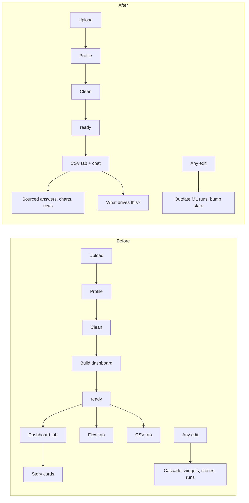
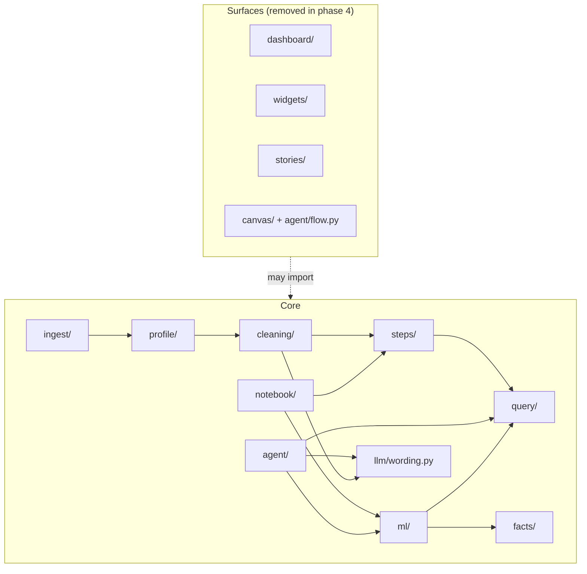

# Plan: focus on cleaning and querying, decouple the dashboard and the Flow canvas

**Status:** owner decision taken (drop the auto-dashboard, focus on cleaning and querying); plan not built. Nothing here is a spec until the PRD and TRD say it (CLAUDE.md Rule 1). Items marked **Owner** need a decision before the phase that uses them; they are collected in §11.

**In one line:** Sherlock becomes "clean a messy CSV you can defend, then ask it anything, with every number sourced". The dashboard builder, the widgets, the story cards and the Flow canvas leave the core path first, then leave the codebase. Cleaning, the CSV tab, chat, ML through chat and the notebook export stay and stop depending on them.

**Names used below** are the code's. "Surfaces" means the four things leaving: `dashboard/` (the builder), `widgets/` (the dashboard's widgets and layout), `stories/` (story cards, fact-sheet narration, synthesis) and `canvas/` plus `agent/flow.py` (the Flow canvas). "Core" means everything that stays.

---

## 1. Why

- **The pitch is sharper.** The judges favour a focused product whose main benefit is obvious at once, and warn against "a complex system for a simple task" (`docs/judges_rubric.md`). Automatic charts are a crowded category; defensible cleaning plus sourced answers is not.
- **The surfaces cost more than they show.** They hold the dataset lifecycle hostage (a dataset only reaches `ready` through `build_dashboard`), run a cascade on every edit, and spend `medium` calls on curation and narration nobody asked for.
- **The trust story survives intact.** Every number in a chat answer is already a chip bound to an executed query (ASK-3). Rule 2 holds without story cards.

---

## 2. What stays, what goes

| Area | Fate | Notes |
|---|---|---|
| Load, profile (LOAD, PROF) | Stays | LOAD-4's status chain loses `building` |
| Cleaning (CLEAN-*) | Stays | Ends in `ready` directly (§5.2) |
| CSV tab (CSV-*) | Stays, becomes the landing view | |
| Chat (ASK-*) | Stays, becomes the query surface | Loses widget, story and canvas intents and actions |
| Chat charts and tables | Stay | `components/charts` stays for chat (§6.4) |
| ML (ML-*) | Stays, reached from chat and a new CSV column header menu | Loses its widget host (§5.5) |
| Notebook export (NB-*) | Stays | Loses widget, card and canvas cells; gains kept answers (§5.6, **Owner** O4) |
| Auto-dashboard (DASH-1, DASH-2) | Goes | |
| Widgets, layout, filters, Add widget (DASH-3 to DASH-11) | Goes | **Owner** O2 |
| Story cards, cascade of stories (STORY-*) | Goes | Wording rules (STORY-3, STORY-8) move to the core (§4.3) |
| Flow canvas (FLOW-*) | Goes | |
| Settings `default_tab`, `story_updates`, `spotlight` | Go | |

### 2.1 The product before and after



---

## 3. Coupling today

These are the couplings that break cleaning or querying if the surfaces are removed as they are. Line numbers are from the current `main`.

### 3.1 Backend

| # | Coupling | Where |
|---|---|---|
| B1 | Only the dashboard builder sets `ready` | `dashboard/builder.py:127,158`, `jobs/build.py:21`; queued by `jobs/clean.py:31,35-43,54-55`, `routers/cleaning.py:254` (Use as is), `jobs/profile.py:48-50` (After upload `never`), `routers/datasets.py:227-228` (restore) |
| B2 | Every new version queues the cascade | `steps/commit.py:67-69`, reached from every step, edit and undo |
| B3 | The Cleaner imports `stories.narrate` at import time, which pulls in `stories.facts` → `agent.compose` → `agent.answerers` → `widgets` | `cleaning/loop.py:54`; the function itself is `stories/wording.py:26`, which only imports `llm.text` |
| B4 | Chat imports the canvas and stories at import time | `agent/loop.py:22,34`, `routers/chat.py:16,27-28`, `routers/proposals.py:9` |
| B5 | Query infrastructure lives in `widgets/` | `widgets/compile.py`, `widgets/execute.py::run_query`, and the generic helpers in `widgets/service.py` (`Env`, `connection`, `user_types`, `selection_sql`, `selection_rows`, `version_row`, `bump_state`), used by chat, ML, the cleaning routes and the dictionary route |
| B6 | Row selections are served by the widgets router | `routers/widgets.py:208-241` (`POST /datasets/{id}/selections`), used by the CSV tab |
| B7 | Chat defaults to the dashboard tab | `routers/chat.py:36`, `agent/loop.py:320,776`, `routers/me.py:30` |
| B8 | Every ML run imports stories and the cascade | `ml/runner.py:38-40` (`widgets.spec.Scope`, `wc`, `ws`), `:394` (`stories.facts.fact`), `:445` (`widget.updated`), `:512-514`, `:547-551`, `:591` (`jobs.cascade.changes`) |
| B9 | Purge imports the canvas and synthesis | `jobs/purge.py:82-108` |
| B10 | The sample seed carries widgets, cards and a canvas | `sample_seed.py:26-27` (`TABLES`) |
| B11 | The notebook exporter reads widgets, cards and the canvas | `notebook/exporter.py:100-107,114,123-212,288-355`; `NotebookOptions` `:33-41` |

No core table has a foreign key into a surface table; every surface table points at `datasets` with `ON DELETE CASCADE` (`db/migrations/001_initial.sql`). `fact_sheets` is shared: ML runs store their sheets there.

### 3.2 Frontend

| # | Coupling | Where |
|---|---|---|
| W1 | `dashboard` is the default and fallback tab | `components/dataset/DatasetPage.tsx:39,57`, `shell/ChatBar.tsx:44`, `api/types.ts:11`; stored `last_tab` values `dashboard`/`flow` |
| W2 | Core shell files import the surfaces statically | `DatasetPage.tsx:10-11,27,31`; `shell/AppShell.tsx:11,20,51` (the stories panel is the default right panel, even on `/`) |
| W3 | `api/queries.ts` imports `api/canvas.ts` | `queries.ts:4`; deleting the canvas client breaks every hook |
| W4 | ChatBar mixes core and dashboard code | `ChatBar.tsx:14,20-21,87,101-102,127-129,198-204,336-374,476-490`; it fetches `GET /widgets` on every tab |
| W5 | Chat blocks link to the dashboard | `chat/Blocks.tsx:96-101` (widget link, "Pin to dashboard") |
| W6 | Status screens and copy assume a build | `dataset/StatusScreens.tsx:70-91` (`BuildingScreen`), `OfferActions.tsx:28,39-42`, `CleaningProgress.tsx:166`, `csv/CsvTab.tsx:92-93,126`, `shell/JobTray.tsx:13` |
| W7 | The dataset stream handles surface events | `queries.ts:476-514` (`widget.updated`, `layout.updated`, `card.updated`, `canvas.updated`, `cascade.*`), `DatasetPage.tsx:129-157` (cascade toast and line), `applyStatus` `:319-324` |
| W8 | The ML UI lives only inside widgets | `dashboard/WidgetShell.tsx:14-17` hosts `AnalysisMenu`, `MlSetup`, `MlResult`; only `ModelCardDrawer` is reachable from chat (`ChatBar.tsx:322`) |
| W9 | Core tests live in surface test files | `dashboard/dashboard.test.tsx:29-40,79-106` (format, JobTray, initials), `ml/ml.test.tsx:76-81` (chat `BlockView`) |
| W10 | The e2e flow runs through the dashboard and Flow | `e2e/flow.spec.ts:22-44,52,56-105,120-132` |

`components/csv`, `components/library` and the cleaning parts of `components/dataset` import nothing from the surfaces.

### 3.3 Docs, tests and evals

- **Process.** Plan §5's never-cut list names "the auto-dashboard" and "grounded story cards with linking", all nine cuts are applied, and plan §2.0 says any further drop needs a PRD change by the owner (§5.1 below does that).
- **Release criterion 3** (PRD §10) is the grounding eval, which measures story cards only (`eval/grounding.py`).
- **About 15 backend test files** use Use as is and wait for `ready` through the build; `test_cleaner.py:93-106,203-209` assert the `build_dashboard` job itself.
- **Evals** `ask`, `notebook` and `web` wait for `ready` and chat with `tab: "dashboard"`; `eval/notebook.py:127-145` checks the app's KPI widgets.

---

## 4. Target architecture

### 4.1 Core modules and the one-way rule



**The rule:** core packages never import a surface package. A test enforces it from phase 1 (§7.1). Surfaces may import the core until they are deleted.

### 4.2 New core package `query/`

It takes the query infrastructure out of `widgets/`, unchanged in behaviour:

| New home | From | What |
|---|---|---|
| `query/compile.py` | `widgets/compile.py` | SQL validation (`validate_select`, `validate_predicate`, `compile_sql`, `rows_clause`, filters, `_parse_one`) |
| `query/execute.py` | `widgets/execute.py::run_query` | Running a query with its timeout. `WidgetCache` stays in `widgets/` and goes with it |
| `query/context.py` | `widgets/service.py` | `Env`, `connection`, `user_types`, `selection_sql`, `selection_rows`, `version_row`, `bump_state` |
| `query/scope.py` | `widgets/spec.py::Scope` | The column and row scope ML requests use |
| `routers/selections.py` | `routers/widgets.py:208-241` | `POST /datasets/{id}/selections` (same path, so the CSV client doesn't change) |

TRD §6.3 currently specifies SQL validation as part of the WidgetSpec. It splits: the SQL and predicate rules become their own subsection (kept at §6.3 so code comments stay valid), and the WidgetSpec part is removed with the widgets.

### 4.3 Shared text and facts

- `stories/wording.py` moves to `llm/wording.py` (it only imports `llm.text`). The Cleaner (`cleaning/loop.py:54`), chat (`agent/loop.py:34`, `agent/answerers.py:24`, `agent/compose.py:18`) and `agent/web.py` import it from there. STORY-3 and STORY-8's wording rules (no digits in prose, numbers only as chips, label checks) move into ASK-3 and CLEAN-6, which already need them.
- The fact constructor and `depends_on` that ML runs use (`stories/facts.py`) move to `facts/` with only what `ml/runner.py:394,492` needs. The `fact_sheets` table stays for ML runs; its `widget_id` column goes (§5.4).
- `jobs/cascade.changes()` (pure step and lineage analysis) moves to `steps/lineage.py`; ML uses it (`ml/runner.py:591`).

### 4.4 Dataset lifecycle

`profiling → offer → cleaning → ready`, with `failed` from profiling. `building` disappears.

| Event | Today | After |
|---|---|---|
| A whole-dataset clean ends | `building`, then `build_dashboard` | `ready` |
| A clean is stopped or cancelled | `building`, then `build_dashboard` | `ready` (the steps already committed stay) |
| A clean fails with an error | `offer` | `offer` (unchanged) |
| Use as is | `build_dashboard` | `ready` |
| After upload = `never` | `build_dashboard`, returns before `offer` | `ready` |
| Restore of a dataset in `cleaning` or `building` | `build_dashboard` | `ready`, or `offer` when the clean never committed a step |

One function, `datasets.mark_ready(db, bus, dataset_id)`, replaces `queue_build` in every caller. `routers/cleaning.py:25-26` `STARTABLE`/`PLANNABLE` stay `("offer", "ready")`, which now covers every finished dataset.

### 4.5 What a new version does

`steps/commit.py:67-69` stops queueing the cascade. Instead, in the same transaction as the commit:

1. `ml.outdate(...)` marks finished runs whose columns changed as `outdated` (PRD ML-9), using `steps/lineage.changes()`.
2. `datasets.state_rev` is bumped (the export cache key, TRD §9).

Both are cheap SQL. The re-run of an outdated analysis is the user's choice from its model card or from chat ("run it again"), which replaces the `story_updates` Automatic / Ask first setting.

### 4.6 Chat as the query surface

- One tool set (today's `csv` set, plus `edit_plan` while a plan is open). The `dashboard` and `flow` tool sets go, and with them `create_widget`, `update_widget`, `explain_widget`, `ask_story`, "make sense of this", the `pin`, `add_to_flow`, `open_widget` and `undo_widget` actions, widget entity resolution (`agent/resolve.py:48-53,79-87,123-128`), `DASHBOARD_WORDS`, `focused_widget_id` and `selected_card_ids`.
- The context the client sends is the CSV selection (`selected_cells`), the open plan (`plan_id`) and the version. `tab` stays in the request for compatibility and is ignored.
- Chart answers keep their chart block. Its spec is the WidgetSpec-shaped dict `compose.chart_block` builds today (`agent/compose.py:148-165`); it is renamed `ChartSpec` in TRD §6.3 and keeps its fields, so the chart adapter doesn't change.
- "Pin to dashboard" is replaced by **Keep in notebook** (**Owner** O4, §5.6).
- `ask_why` and `ask_model` stay (ML through chat). `insight.pick_run` (`agent/insight.py:401-403`) drops its focused-widget branch and keeps the newest-run fallback.

### 4.7 The web app

- **One view per dataset:** the CSV grid in the centre, the chat bar below, and the right panel showing the cleaning plan, the cleaning report and the Changes panel (today's `CsvSidePanel`). The tab switcher goes. `/d/:id` and `/d/:id/:tab` both render it, so old links and stored `last_tab` values still land somewhere valid.
- **`/` (Home):** the right panel shows the library tips instead of the stories panel.
- **ML entry:** a new right-click menu on a CSV column header (a click still sorts, `csv/Grid.tsx:5`) with one item, "What drives this column?", which sends that question to chat through the existing `chatOutbox` (`state/ui.ts:48`). The answer shows the importance table and the model card link, as `ask_why` does now (**Owner** O3).
- **Status screens:** `BuildingScreen` goes. When a clean finishes, the cleaning report stays open in the right panel and the grid becomes editable.

---

## 5. Changes by area

### 5.1 Docs and process (lands first, in the commit that starts phase 2)

- **Plan §5 cut order:** add cut 10 (auto-dashboard and widgets: DASH-1 to DASH-11, P0-04), cut 11 (story cards: STORY-*, P0-07) and cut 12 (Flow canvas: FLOW-*, P0-08). Edit the never-cut list to "headless cleaning with a report, ask-anything with sources, the deploy, the cached sample, and notebook export (at minimum: load, steps, ML runs, kept answers)". Remove "§5 has nothing left to cut" from plan §2.0.
- **PRD:** keep every requirement row so IDs stay stable; mark each removed one "Removed by cut 10/11/12". Rewrite §1 (one line, problem, product), §2.1 goals 3, 5 and 7, §3.2, §4 metrics, §6 concepts (drop Widget, Story card, Canvas, Cascade), §8, §10 criterion 3, §12.3 and §12.5. Reword the class-c rows the docs inventory found: P0-03, P0-06, P0-09, P0-12, LOAD-4, PROF-3, CLEAN-1, CLEAN-4c, CLEAN-5, CLEAN-10, ML-1, ML-2, ML-9, ML-11, ASK-2, ASK-4, ASK-5, ASK-6, ASK-10, settings §7.10, QoL §7.11, NB-1, NB-5, NB-9, NB-10, NB-12.
- **New positioning line (PRD §1):** "Sherlock cleans a messy CSV into data you can defend, then answers any question about it. Every change is a step you can undo, every number in an answer comes from a query you can open, and the whole thing exports as a runnable notebook."
- **App Flow:** rewrite §1 (map, routes), §3, §4 and §5 endings, §8, §9 (ML from chat and the column header menu), §10, §14, §15, §17 and §18; remove §6, §7, §11, §12 and §16, leaving each heading with "Removed by cut N" so numbers stay stable.
- **UI/UX brief:** mark §3.3, §4.3, §4.5, §5.5 and §5.10 removed; reword the class-c sections (tabs, chips, chat chips, export dialog, settings, a11y screens).
- **TRD:** see the table in §8.
- **Schema:** mark §2.9, §2.11 and §2.12 removed; edit §2.2 (`status`, `last_tab`, `state_rev`), §2.10 (`fact_sheets` for runs only, `relations` removed), §2.13 (`runs.widget_id` removed), §2.14 (job kinds), §2.16, §2.18 (purposes), §2.19, §5, §6 and §7.
- **Help** (`docs/help`, the `app_help` sources): delete `dashboard.md`; rewrite `getting-started.md`, `analysis.md`, `chat-and-export.md`, `csv-tab.md`.
- **CLAUDE.md "Why" and stack lines, README:** rewrite in phase 5.

### 5.2 Lifecycle (backend)

- Add `mark_ready` (§4.4) and call it from `jobs/clean.py` (end and cancel), `routers/cleaning.py` (Use as is), `jobs/profile.py` (After upload `never`, then return) and `routers/datasets.py` (restore).
- `POST /datasets/{id}/use-as-is` returns the dataset instead of a job. Generate the client again (`web/src/api/schema.d.ts`).
- Migration `009_focus.sql`: `UPDATE datasets SET status = 'ready' WHERE status = 'building'`; cancel queued or running `build_dashboard`, `stories` and `cascade` jobs; `UPDATE datasets SET last_tab = 'csv' WHERE last_tab IN ('dashboard', 'flow')`.

### 5.3 Chat (backend)

- `agent/loop.py`: one `TOOLS` set; remove the intents, actions and gates listed in §4.6; remove `_which_widget`, the widget option of `choose`, the export wording about cards and canvas notes (`:648-652`), and `create_widget` for the Add widget drawer (`:767-774`).
- `agent/answerers.py`: remove `create_widget`, `update_widget`, `_save_widget`, `_spec`, `widget_title`, `explain_widget`.
- `agent/prompts.py`: remove the `WIDGET` and `UPDATE_WIDGET` prompts and the intent lines; entities lose "widget titles or card names".
- `llm/schemas.py`: `INTENTS` and `Entity.kind` lose the widget, card and story entries; `Curation`, `Pick` and `WidgetDraft` go. `TextRun`, `ChipRun`, `LabelRun` stay (compose uses them); `Story` goes.
- `routers/chat.py`: `POST /messages/{mid}/pin` becomes `POST /messages/{mid}/keep` (O4) or goes; `tab` defaults to `csv` and is ignored.
- `agent/actions.py:43-45`: export options lose `include_cards` and canvas notes.

### 5.4 Data and storage

- Migration `010_drop_surfaces.sql` (phase 4): drop `widgets`, `layouts`, `widget_cache`, `relations`, `cards`, `canvases`; delete `fact_sheets` rows that belong to widgets or cards; drop `runs.widget_id` and `fact_sheets.widget_id`.
- `jobs/purge.py`: remove the widget, card and canvas sections (`:82-108`) and the `widget_cache` cleanup (`:116`); `LOOSE_TABLES` keeps `fact_sheets`.
- `ownership.py:21-22,28`: drop the `widget` and `card` owned kinds.
- **Sample seed:** regenerate with `scripts/seed_sample.py` so it holds the cleaned version, steps, profile and chat thread but no widgets, cards or canvas; `sample_seed.py` `TABLES` follows. The seed's `job_events` lose the surface events.

### 5.5 ML

- `ml/runner.py`: take `Scope`, the query helpers and `fact` from the core (§4.2, §4.3); remove `link`, `widget_data`, `rerun_widget`, the `widget.updated` emits, `ws._stories` and `mark_widget_card`. A run is launched by chat (`ask_why`, "run it again") or by `POST /runs`.
- `routers/runs.py`: remove the `widget_id` branch (`:67-75`) and `POST /widgets/{wid}/rerun` (`:152-163`).
- The `story_updates` "Ask first" behaviour (`ml.ask_first`) goes; outdated runs are re-run on request (§4.5).
- PRD ML-1 ("every widget has an analysis dropdown") is reworded to the two entry points in §4.7; ML-2 (the builder's driver widget) is removed by cut 10.

### 5.6 Notebook export

- `notebook/exporter.py`: remove `_widgets`, the "## The dashboard" section, `_cards`, `_flow_cards`, `_canvas_notes` and the overview card; `_extra_runs` becomes "every finished run on the current lineage" (still capped at ten).
- `NotebookOptions` loses `include_cards`, `include_notes` and `order`.
- `notebook/cells.py`: remove `widget`, `card`, `flow_intro`, `note`; `title()` loses `widgets=`.
- **Kept answers (O4, recommended):** "Pin to dashboard" becomes **Keep in notebook** on any `ask_data` or `find_rows` answer. The exporter writes one section per kept answer: the question as Markdown, its SQL, and its result table (and chart, through the existing plot helpers). This is a new requirement, NB-13, so the notebook still reproduces what the user found, not just what they cleaned.
- Regenerate `docs/examples/titanic3-v4.ipynb` with `scripts/example_notebook.py`.

### 5.7 Web app

| Change | Files |
|---|---|
| One dataset view; `Tab` type and tab switcher go | `api/types.ts:11`, `DatasetPage.tsx:25,27,31,39,57,58-68,78,82-83,90-91,189-209`, `shell/CenterHeader.tsx:7-11` |
| Right panel is the cleaning side panel; library tips on `/` | `shell/AppShell.tsx:11,20,43,51,99` |
| Status screens without a build | `StatusScreens.tsx:70-91`, `OfferActions.tsx:28,39-42`, `CleaningProgress.tsx:166`, `CsvTab.tsx:92-93,105,126`, `JobTray.tsx:13`, `ExportDialog.tsx:131`, `LibraryPanel.tsx:213` |
| Chat without surface features | `ChatBar.tsx:14,20-21,25-27,44,87,101-102,126-131,150-152,198-204,336-374,383,476-490`; `chat/Blocks.tsx:96-101` (Keep in notebook replaces Pin); `api/types.ts:287-288,312-318,324` |
| Dataset stream without surface events | `api/queries.ts:21-25,319-324,385-465,476-514,569-589` (and the `canvas` import at `:4`); `DatasetPage.tsx:127-157`; `api/ml.ts:192-196` |
| State | `state/ui.ts:38-45,58-59,112-114` lose the widget and cascade fields; `state/filters.ts` and `state/flow.ts` go |
| ML entry from a new column header menu (right-click; there is no header menu today) | `csv/Grid.tsx` → `chatOutbox`; `ml/AnalysisMenu.tsx` and `ml/MlSetup.tsx` go unless O3 keeps a setup form |
| Export dialog | `ExportDialog.tsx:17-28,140-158`; `DatasetMenu.tsx:50` copy |
| Settings | `SettingsDialog.tsx` unchanged (it never showed `default_tab` or `story_updates`); the generated `Settings` type loses them |
| Deleted folders (phase 4) | `components/dashboard`, `components/stories`, `components/flow`, `api/canvas.ts`, `api/stories.ts` |
| Packages removed (phase 4) | `react-grid-layout`, `@types/react-grid-layout`, `@xyflow/react`, `@tiptap/*`; also the already unused `lodash`, `marked`, `react-responsive-carousel`. `@visx/*`, `d3-*` and `motion` stay for chat charts |

---

## 6. Phases

Each phase ends green on the full check (§7.3) and is committed and pushed. Docs change in the same commit as the code they describe (Rule 1). Phases 1 to 3 are needed whatever O1 decides; phase 4 is the deletion.

### Phase 0: decide

- Answer O1 to O7 (§11).
- Tag the last commit with the surfaces in place (`git tag pre-focus`), so anything can be restored from it.

### Phase 1: extract the shared core (no behaviour change)

1. Create `query/` (§4.2), `llm/wording.py`, `facts/` and `steps/lineage.py` (§4.3). Move the code, update every caller, leave no re-export shims.
2. Move `POST /selections` to `routers/selections.py`.
3. Move the core tests out of surface test files: the compile and validation tests and `test_selections` from `test_widgets.py` to `test_query.py`; `test_change_detection.py`'s `changes()` cases to `test_lineage.py`; in the web app, the format, JobTray and initials tests from `dashboard.test.tsx` and the `BlockView` test from `ml.test.tsx` (W9).
4. Add the import-boundary test (§7.1) with an allow-list of the couplings still left (B1, B2, B4, B7 to B11). Each later phase shrinks the list; phase 4 empties it.
5. Docs: TRD §2 (layout), §6.3 split; Schema unchanged.

**Exit:** the full check passes with no behaviour change; the e2e test is untouched and green.

### Phase 2: the core stops needing the surfaces (behaviour change)

1. Docs first, in the same commit as the code: §5.1 (cut rows, never-cut list, PRD, App Flow, UI/UX, TRD, Schema, help).
2. Backend lifecycle (§4.4, §5.2), new-version hook (§4.5), chat (§4.6, §5.3), ML (§5.5), purge (§5.4 without the drop), exporter (§5.6), migration `009_focus.sql`.
3. `main.py` stops registering `jobs/build.py`, `jobs/stories.py` and `jobs/cascade.py` and stops including the widgets, cards and canvas routers. `jobs/runner.py` `KINDS` and `SERIAL_KINDS` lose those kinds.
4. Web app (§4.7, §5.7) except the folder and package deletions.
5. Tests: rewrite the backend tests that waited for `ready` through the build (they now wait for `ready` directly); rewrite `test_cleaner.py:93-106,203-209`; update `test_prompt_hygiene.py:130-161,189` (the purpose set loses `curate`, `narrate`, `overview`, `synthesis`, `ask_story`, `widget`, `update_widget`); rewrite the web tests that asserted dashboard copy (`App.test.tsx:47,65,72-74,87`, `follow-version.test.tsx`, `chatbar.test.tsx`, `shell.test.tsx:14-16`, `export.test.tsx`, `csvtab.test.tsx:24`, `cleaning.test.tsx:102,119`, `test/render.tsx:12`).
6. The e2e flow is rewritten (§7.2).
7. Evals: §7.4.
8. Kept answers (O4) and the column-header ML entry (O3) if the owner said yes.

**Exit:** the full check passes; the app never shows a dashboard, story card or canvas; the surfaces' code is still in the tree but unreachable; the boundary test's allow-list holds only "surface packages exist".

### Phase 3: verify on the deployed app

- Deploy by hand (push, then a Manual Deploy on Render), confirm `/healthz` reports the new commit.
- Run the five-file set (plan §6) through upload → clean → ask → edit → undo → export on the deployed app, plus `sherlock eval corruption` and `sherlock eval ask --live`.
- Fix what breaks before phase 4.

### Phase 4: delete the surfaces

1. Delete `dashboard/`, `widgets/` (what's left: `service.py`, `layout.py`, `spec.py`, `WidgetCache`), `stories/`, `canvas/`, `agent/flow.py`, `jobs/build.py`, `jobs/stories.py`, `jobs/cascade.py`, `routers/widgets.py`, `routers/cards.py`, `routers/canvas.py`, `eval/grounding.py`, `scripts/live_check.py` parts that check the cascade.
2. Delete their tests (`test_dashboard.py`, the rest of `test_widgets.py`, `test_stories.py`, `test_canvas.py`, `test_claims.py`, `test_grounding_eval.py`) and fixtures (`dashboard_curate.json`, `stories_titanic.json`, `flow_titanic.json`; drop the `widget` and `update_widget` entries from `chat_titanic.json` and `chat_actions.json`).
3. Migration `010_drop_surfaces.sql` (§5.4); regenerate the sample seed.
4. Web: delete the folders and packages in §5.7; regenerate `schema.d.ts` and `openapi.json`.
5. The boundary test's allow-list is empty.
6. Docs: the "Removed by cut N" rows stay; TRD §2 layout, §3.3, §3.5, §4.5 to §4.7, §5.1, §7.3, §7.4, §7.6, §9, §14 lose the code they described.

**Exit:** the full check passes; `rg -i "widget|story card|canvas|cascade" api/sherlock web/src` finds only the chart block's internals and intentional history in migrations.

### Phase 5: the submission

- README: pitch, try-it steps, model table (`large` cleans, `medium` answers and judges fixes, `small` routes), the Mermaid diagram, "How trust works" (chips in answers, steps, quarantine), results (corruption eval, ask eval, notebook eval).
- Plan §9 video script: messy file → the cleaning plan and log → quarantined rows and why → undo one step → ask three questions (a number, a chart, a "what drives") → "How do you know?" on a chip → edit a cell from chat → export the notebook and run it.
- CLAUDE.md "Why" and stack lines; PRD §12.2 submission form text.
- Regenerate `docs/examples/titanic3-v4.ipynb`.

---

## 7. Verification

### 7.1 The import boundary

A pytest walks the AST of every module under `api/sherlock` and fails when a core package imports a surface package (at module level or inside a function). Core packages: `ingest`, `profile`, `cleaning`, `steps`, `query`, `facts`, `rows`, `agent` (except `agent/flow.py`), `ml`, `notebook`, `llm`, `jobs` (except `build`, `stories`, `cascade`), `routers` (except `widgets`, `cards`, `canvas`), `sample_seed`, `main`. A web counterpart (a vitest that greps imports, or an ESLint `no-restricted-imports` rule) forbids `components/csv`, `components/chat`, `components/shell`, `components/dataset`, `components/library`, `api/queries.ts` and `state/*` from importing `components/dashboard`, `components/stories`, `components/flow`, `api/canvas` or `api/stories`.

### 7.2 The new e2e flow

`web/e2e/flow.spec.ts`, one test, on the recorded fixtures (`LLM_MOCK`, which match by prompt substrings, `llm/fixtures.py`):

1. Try with sample → the offer → Clean it myself (or the cached cleaned sample) → the URL is `/d/:id`, the grid is editable, the cleaning report is in the right panel; axe on that screen.
2. Ask a number question in chat → the answer has a chip → "How do you know?" shows the SQL.
3. Ask for a chart → a chart block renders; Keep in notebook (O4).
4. Ask "what drives survived?" → the importance table and the model card link.
5. Ask for a cell edit → the proposal → approve → the grid shows the new value → any outdated run shows its badge.
6. Export the notebook from the Dataset menu → the file downloads and holds the kept answer.
7. Undo the edit in the Changes panel.

The chat fixtures recorded with `tab: "dashboard"` should still match, since matching is by prompt substrings; re-record with `LLM_RECORD` only the entries that miss.

### 7.3 The full check, every phase

```bash
uv run pytest
```

```bash
corepack pnpm typecheck
```

```bash
corepack pnpm test
```

```bash
corepack pnpm e2e
```

```bash
uv run sherlock eval ask
```

Plus `uv run sherlock eval corruption`, `eval ml`, `eval notebook` and `eval web` (offline). CI is blocked, so these run locally before each push.

### 7.4 Evals

| Eval | Change |
|---|---|
| `grounding` | Retired with the story cards. Release criterion 3 becomes "unsourced numbers in chat answers = 0", which `eval ask` already counts (ASK-3) |
| `ask` | Waits for `ready` without a build (`eval/ask.py:136-147`); chats without `tab` (`:122`); `card` leaves the source kinds (`:115`, `samples/eval/ask_questions.yaml:12`) |
| `notebook` | Drops the KPI-widget comparison (`eval/notebook.py:102,127-145`). It checks instead that the notebook's final data matches the app's current version (row count, column set, a checksum of the usable rows) and that each kept answer's table matches the app's result |
| `web` | `tab` (`:101`), the `wording` import (`:131`), the accepted statuses (`:194`) |
| `corruption`, `ml` | Unchanged |

---

## 8. TRD sections touched

| § | Change |
|---|---|
| §1 | Overview: pipelines are Cleaner, chat and ML runner; no DashboardBuilder or Storyteller |
| §2 | Layout: `query/`, `facts/`, `llm/wording.py`, `steps/lineage.py`; surfaces removed |
| §3.3 | Job kinds and `SERIAL_KINDS`; "a clean after Stop" ends in `ready` |
| §3.5 | Fallbacks and schemas for curation and narration removed |
| §4.1, §4.2 | Settings lose `story_updates`, `spotlight`, `default_tab`; `Dataset.status` loses `building`; `last_tab` loses `dashboard`/`flow`; sample seed; `NotebookOptions` |
| §4.3 | `POST /selections` moves to `routers/selections.py` |
| §4.4 | `POST /use-as-is` returns the dataset |
| §4.5 to §4.7 | Removed by cuts 10 to 12 |
| §4.8 | Runs without widgets |
| §4.9 | `pin` becomes `keep` (O4) |
| §5.1 | Events lose `widget.updated`, `layout.updated`, `card.updated`, `canvas.updated`, `cascade.*` |
| §6.3 | SQL and predicate rules stand alone; `ChartSpec` for chat chart blocks |
| §6.4 | Fact sheets for ML runs only |
| §7.1, §7.2 | Profile and Cleaner endings go to `ready`; `llm.wording` |
| §7.3, §7.4, §7.6 | Removed by cuts 10 to 12 |
| §7.5 | Run outdating on a new version (§4.5) |
| §7.7 | Notebook contents (§5.6) |
| §8.1 to §8.3 | One tool set; intents and actions removed (§4.6) |
| §9 | Caching without widget data or fact sheets of cards |
| §12, §13, §14 | Error boundary, performance targets, tests and evals (§7) |

---

## 9. Risks

| Risk | Mitigation |
|---|---|
| The demo loses its visual payoff | Chat chart answers keep the Bklit and visx charts; the cleaning log and report are the visual centre of the video |
| A dataset gets stuck in `cleaning` or `building` | Migration `009` moves `building` to `ready`; `mark_ready` is called on every clean ending, including cancel; a test covers each row of the §4.4 table |
| An edit leaves an ML result silently stale | The new-version hook outdates runs in the commit's transaction; a test edits a feature column and checks the run is `outdated` |
| Recorded LLM fixtures miss after prompt changes | Fixtures match by substring; re-record only the misses with `LLM_RECORD` |
| Concurrent sessions commit to `main` while this lands | Work in a worktree, fast-forward merge, never push other sessions' commits |
| The notebook gets thinner | Kept answers (O4) put the user's findings back in, as runnable SQL with results |
| Removing scope breaks Rule 5's process | Cuts 10 to 12 and the never-cut edit go through plan §5 and the PRD in the first commit of phase 2 |

---

## 10. Out of scope

- Redesigning chart selection inside chat answers.
- A saved-queries panel, query history search or scheduled queries.
- Any change to the Cleaner's detectors or severity (`docs/plans/cleaner-detectors-and-severity.md` is unaffected; its only story touch, `stories.wording.wording_problem`, moves to `llm/wording.py`).

---

## 11. Owner decisions

| # | Question | Recommendation |
|---|---|---|
| O1 | Delete the surfaces (phase 4) or keep them in the tree, unreachable? | Delete. Dormant code still has to be described by the docs (Rule 1) and tested, and the `pre-focus` tag keeps it recoverable |
| O2 | Does a manual dashboard (pinning chat charts) survive? | No. Chat answers are the query surface; Keep in notebook replaces Pin |
| O3 | How is ML reached without widgets? | Chat (`ask_why`, "run it again") plus "What drives this column?" in a new right-click menu on the CSV column header, sending the question to chat |
| O4 | Do kept chat answers go into the notebook (new NB-13)? | Yes; otherwise the export has load, steps and ML runs only |
| O5 | Does the cached sample arrive cleaned, or does the demo run the clean live? | Cached cleaned, so "Try with sample" is instant, with "Clean again" available; the video shows a live clean on a second messy file |
| O6 | What does a cancelled clean leave? | `ready` with the steps it committed, and the report says which fixes it didn't reach |
| O7 | If phase 4 isn't green before the submission freeze, submit after phase 3? | Yes. Phase 3 is a complete product; the docs then say the surfaces' code is unreachable and removed by cuts 10 to 12 |
